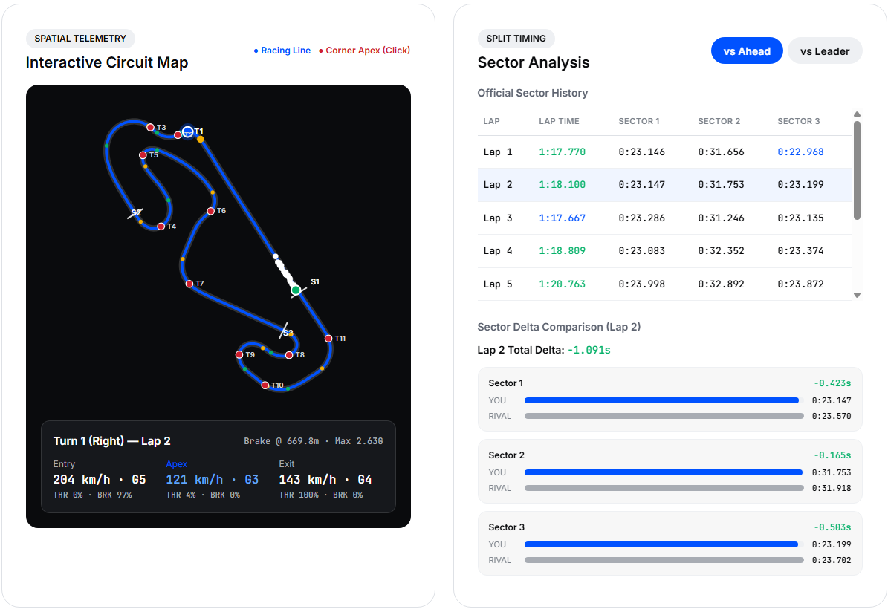
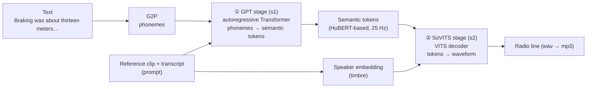

# 🏎️ F1 AI Race Engineer Dashboard

> **Institutional-grade telemetry, corner-by-corner kinematics, and real-time race strategy for F1 25 / F1 26.**

> 🇰🇷 한국어 안내: [README_ko.md](README_ko.md)

## 🚀 How to Run (live race + engineer radio)

### 1. Install & start
Tested on Windows 11, Python 3.12, EA SPORTS™ F1 25. No Node.js needed — the built UI (`project/frontend/dist`) is included.

```bash
pip install -r project/requirements.txt
```

```bash
python project/run_app.py
```

Your browser opens at `http://localhost:8080`.

### 2. In-game settings (Settings → Telemetry)
| Setting | Value |
|---|---|
| UDP Telemetry | **On** |
| UDP Broadcast Mode | Off |
| UDP IP Address | `127.0.0.1` |
| UDP Port | `20777` |
| UDP Send Rate | 60 Hz (recommended) |

### 3. App setup screen
1. **Turn OFF "Recorded Telemetry Replay".** It is on by default and replays recorded data instead of the live game.
2. Keep **AI engineer voice briefing (TTS)** **ON** (default).
3. Click **"Connect & Start Session"**, then enter any Practice / Qualifying / Race session in the game.
4. Make sure **"Auto Radio"** in the radio panel is **ON** (default).

### 4. When the engineer talks
The session type is detected from the game data (`m_sessionType`) and shown as a header badge (e.g. `🏁 Race`).

| Radio call | Trigger | Practice | Quali | Race |
|---|---|:-:|:-:|:-:|
| **Radio check** | Right after the session starts; again when the session changes | ✅ | ✅ | ✅ |
| **Corner braking** *"Braking was about 13 meters early on entry."* | **From lap 2.** Leaving each corner (+15 m past the exit), this lap's braking point is compared with the session's fastest lap: 5–45 m difference (Race: 10–45 m) | ✅ | ✅ | ✅ |
| **Pace strong** *"Pace is very strong…"* | **From lap 3.** Last lap 0.2–1.0 s faster than the one before | ✅ | ✅ | ✅ |
| **Pace drop** *"Pace dropped by roughly half a second…"* | Last lap 0.45–1.0 s slower | ✅ | ✅ | ✅ |
| **Pace drop + box** *"Pace dropped by 1.3 seconds… box this lap!"* | Last lap ≥ 1.0 s slower | — | — | ✅ |
| **Gap ahead** *"Gap to car ahead is 0.8 seconds, DRS available."* | Once per lap, 150–600 m after the line, when the gap is under 10 s | — | — | ✅ |
| **Pit window / box** | Any tyre ≥ 38 % worn → window open; ≥ 45 % → box this lap (once each per session) | — | — | ✅ |
| **Traction** *"Exit traction was down…"* | Slowest corner exit of the last lap below 110 km/h (once per session) | ✅ | — | ✅ |
| **Tyre degradation** *"Soft tyre degradation is high, over five percent per lap…"* | Last lap's wear rate ≥ 5 %/lap (≥ 10 % → critical), compound-specific line | ✅ | — | ✅ |
| **Setup advice** *"The car is front limited. Try two clicks more front wing…"* | **From lap 3.** Based on the last 2 laps' tyre temperatures and wear ([setup guide](project/docs/SETUP_GUIDE.md)); on the main straight, same advice at most every 4 laps | ✅ | — | — |

* There are **at least 6 s** between calls; corners passed during that gap are skipped.
* Lap 1 has no reference lap yet, so there are no braking calls.
* **Laps with a safety car / VSC or a pit stop** are left out of pace comparisons and setup analysis (no false "box this lap").
* Setup advice shows **current → suggested values** (e.g. `Front wing 36 → 38`) and the data behind it (average tyre temperatures, wear per lap) in the radio panel.

### 4-1. Ask the engineer
In the radio panel's **"🎧 Ask the engineer"** box, tap a preset or type a question. The engineer answers from the live data with **voice + text (English / Korean) + the numbers behind it**.

| Question (Korean or English) | What the engineer tells you |
|---|---|
| **How can I win?** / 1등 하려면 어떻게 해야 해? | Gap to the leader, **time needed per lap** over the remaining laps, the sector you lose most. If it needs > 3 s/lap: "focus on the car ahead" |
| **Can I catch the car ahead?** / 앞차 잡을 수 있어? | Gap ahead, closing (or losing) rate per lap, **laps until DRS range**, the sector you lose most to him, a tip based on tyre age |
| **Where am I losing time?** / 어디서 시간을 잃고 있어? | Last lap vs best lap per sector, **the corner with the biggest braking difference** |
| **How are my tyres?** / 타이어 상태 어때? | Worst tyre wear and temperature state (in window / fronts hot / rears hot / cold) |
| **When should I pit?** / 언제 피트인 해야 해? | **Laps until 45 % wear** from the wear rate → "box in N laps" or "tyres will make it" |
| **Any setup changes?** / 셋업 어떻게 바꿔야 해? | Advice from the [setup guide](project/docs/SETUP_GUIDE.md) rules + current → suggested values |
| **What's the gap?** / 갭 알려줘 | Gap ahead and gap to the leader |

* Intent is matched by keywords (e.g. "catch", "overtake", "앞차" → catching the car ahead). Anything else gets *"Say again…"*.
* Win / catch / pit / gap questions are race-only; other sessions get *"That one is for the race…"*.
* Answers are stitched from pre-baked sentences (including per-number variants). With TTS off they are shown as text only.

### 4-2. TV overlay (broadcast graphics over the game)
[f1-25-tv-overlay](https://github.com/thenotrealuser/f1-25-tv-overlay) (MIT) is included in `project/overlay/`. It draws a timing tower, qualifying cut-off, lap card (live S1/S2), onboard card, halo instruments (speed, gear, RPM, ERS), flags / SC / VSC and a fastest-lap banner transparently over the game.

1. Install **Node.js 18+** ([nodejs.org](https://nodejs.org)).
2. Set the game's display mode to **borderless / windowed fullscreen** — exclusive fullscreen can't be drawn over.
3. **Nothing to do — it is ON by default.** The app listens for the game from launch, and the overlay **appears by itself as soon as the game sends telemetry** (no need to open a dashboard; nothing is drawn before that). One switch turns it on/off — the **"📺 TV Overlay"** card on the setup screen or the **📺 TV** button in the dashboard header — and the choice is remembered.
   * Button states: `TV OFF` · `TV READY ●` (armed, waiting for game data) · `TV STARTING…` · `TV ON ●` (showing live data) · `TV INSTALL` / `INSTALLING…` · `TV ERROR` (hover for details).
   * The overlay window (Electron, ~370 MB) is downloaded **once, only when you click** `TV INSTALL` (or "Install" on the setup card) — never automatically.
   * Telemetry is recorded to `lap*.jsonl` only while a live dashboard is open; the overlay on its own records nothing.
4. Hotkeys: **Ctrl+Alt+H** show/hide all, **Ctrl+Alt+E** layout edit mode (drag elements), Ctrl+Alt+T tower, Ctrl+Alt+L lap card, Ctrl+Alt+G halo, Ctrl+Alt+F flags.
5. Detailed settings page: `http://127.0.0.1:8090/control`
6. Look: a **broadcast theme** by default (`project/overlay/theme-broadcast.css`), with tower position, size and row height matched pixel-for-pixel to an in-game broadcast overlay, set in **Saira at 118 % width** — the closest free match to the broadcast type. Official logos, fonts and team logos are not in the repo — **drop your own into `project/overlay/local-assets/`** and they are used automatically (file names in that folder's README). Original design: `http://127.0.0.1:8090/?theme=original`.
7. **TV-pod halo HUD** (made for the game's centred TV-pod camera): switched **on automatically** when the overlay starts (the game doesn't report the camera; Ctrl+Alt+G hides it). The speed dial sits at the centre of the screen under the halo, with brake (left) and throttle (right) as segment arcs around it. Everything on it comes from telemetry — speed, gear, brake/throttle, ERS battery, Boost / Overtake / Active Aero state (2026 packet 16), the viewed car and the car ahead, an **RPM bar scaled to the car's max RPM**, and the **official turn number**: our corner data for 24 tracks is written to `project/overlay/curvas/` at start, so TURN works from the first lap instead of after a learning lap. If your camera sits slightly differently, move/scale the whole halo in edit mode or `/control`.

**How it works:** the game can only send UDP to one port, so our app receives on 20777 and **forwards every packet to the overlay on 20778**; the overlay's page is served on 8090 (our dashboard uses 8080). **Replays work too** — recorded packets are re-encoded to the binary 2026 layout and sent to the overlay, so you can try it without the game. Leaving the dashboard (EXIT) keeps the overlay running while the switch is ON; switching OFF or closing the app closes it.

### 5. Known limitations
* **Corner braking calls and the "biggest loss corner" answer work on the 24 tracks with corner maps** (all current calendar tracks). They are switched off on reverse layouts (Silverstone / Austria / Zandvoort reverse) and Madrid, which have no corner map yet. A few flat-out kinks are not mapped (Jeddah T22–26, Baku T15/T20, Las Vegas T11).
* Setup thresholds are F1-game setup rules of thumb ([setup guide](project/docs/SETUP_GUIDE.md)) — check the lap time after applying them.
* A race lap that is ≥ 1 s slower because of traffic can still trigger a box call (safety car and pit laps are excluded).
* Live mode records telemetry to `project/backend/data/circuit_<track>/lap*.jsonl` (~100 MB per lap); these files feed replay mode.

### 6. Replay mode
* After driving in live mode, turn on "Recorded Telemetry Replay" and pick **circuit → session (Practice 1 / Race #1 …) → lap**.
* The raw recordings (`*.jsonl`) are too large for the repository, so **on a fresh clone you need to record your own sessions first**.

### 7. What works on a fresh clone
| Feature | Status |
|---|---|
| Live dashboard + engineer radio + Q&A | ✅ Steps 1–3 only (all 639 voice files included) |
| Replay | After you record your own sessions |
| TV overlay | ✅ Needs Node.js 18+ (Electron is installed automatically on first use) |
| Generating new radio lines | ❌ Needs the fine-tuned model and a GPT-SoVITS environment (not in the repo) — see [AI Race Engineer Voice](#️-ai-race-engineer-voice-gpt-sovits-few-shot-fine-tuning) |

---

A high-performance web dashboard that captures real-time high-speed UDP telemetry (port `20777`) from EA SPORTS™ F1 25 / F1 26, analyzing turn-by-turn kinematics, tire degradation, and circuit telemetry to provide drivers with professional pitwall-grade engineering insights.

Built with the Coinbase Design System aesthetic—combining a deep dark hero band, crisp white editorial canvas, soft surface elevations, and tabular `JetBrains Mono` typography for high data density and readability.

---

## 📸 Screenshots

| 1. Session Configuration & Replay | 2. Lap Archive & Corner Telemetry |
| :---: | :---: |
|  |  |
| Replay circuit selection, 60Hz UDP port, AI voice persona | Multi-lap history, corner entry/apex/exit metrics, setup & wear |

| 3. Turn-by-Turn Kinematics Matrix | 4. Interactive Circuit Map & Sectors |
| :---: | :---: |
|  |  |
| Full corner table (T1~TN) with speed, gear, pedals, brake point, G-force | Vector racing line, clickable dynamic apex markers, split timing |

---

## ✨ Key Features

### 1. Advanced Session Configuration & Replay
* **Live & Replay Modes**: Stream live from the game at 60Hz or replay pre-recorded telemetry files (Catalunya 9 Laps, Austria, etc.) at 1x to 4x playback speed.
* **i18n & Unit Conversion**: Real-time switching between English (ENG) / Korean (KOR) and Metric (km/h, °C) / Imperial (mph, °F).
* **AI Engineer Persona**: Select your race engineer voice persona (GP for Max Verstappen, Bono for Lewis Hamilton, Ricky for Carlos Sainz).

### 2. High-Fidelity Packet Parsing & Kinematics Engine
* **Full C-Struct Parsing**: `Packet 0` (Motion), `Packet 1` (Session), `Packet 2` (Lap Data), `Packet 4` (Participants), `Packet 5` (Car Setups), `Packet 6` (Car Telemetry), `Packet 10` (Car Damage), `Packet 11` (Session History).
* **Turn-by-Turn Telemetry & Kinematics**:
  * Entry, Apex, and Exit speeds (`km/h`), gear selection, throttle %, and brake %.
  * Precise Braking Point (`m`) detection and Throttle-On (`m`) re-application point.
  * Lateral G-load (`Max G`) and live rival comparison (`vs Ahead` / `vs Leader`).

### 3. Interactive Multi-Lap History
* Click any completed lap (`Lap 1` through `Lap 9`) or `LIVE` buffer to inspect turn-by-turn telemetry cards.
* Official millisecond lap and sector times (`S1, S2, S3`) directly parsed from `SessionHistory`.

### 4. Interactive Circuit Map
* Smooth SVG vector racing line generated from high-density circuit coordinates.
* Interactive corner markers (`T1 ~ T11`) tracking the driver's dynamic apex (actual minimum speed location) per lap.
* Click any corner on the map to inspect its telemetry profile.

---

## 🎙️ AI Race Engineer Voice (GPT-SoVITS few-shot fine-tuning)

The engineer's radio calls are generated by **[GPT-SoVITS](https://github.com/RVC-Boss/GPT-SoVITS) v2ProPlus**, fine-tuned on about **3 min 36 s** of the target voice. So the game never has to share the GPU with a TTS model, every radio line is **pre-baked** offline and the app only picks and plays the right file.

### Models
| Role | Model |
|---|---|
| Text-to-speech | GPT-SoVITS **v2ProPlus** — pretrained weights from `lj1995/GPT-SoVITS` (`s1v3.ckpt`, `v2Pro/s2Gv2ProPlus.pth`, `s2Dv2ProPlus.pth`) |
| Speech features | `chinese-hubert-base` (HuBERT self-supervised speech representation) |
| Speaker embedding | `sv/pretrained_eres2netv2w24s4ep4.ckpt` (ERes2NetV2 speaker-verification model, used by v2Pro) |
| Transcription & QA | faster-whisper `small.en` |

### How it works
GPT-SoVITS splits speech generation into **what to say and how** and **whose voice says it**.



1. **G2P:** text becomes phonemes. Numbers are spelled out first (`13` → *thirteen*, `0.8` → *zero point eight*).
2. **GPT stage (s1, Text2Semantic):** given the phonemes and a reference prompt, it predicts a sequence of **semantic tokens** — quantised HuBERT speech features at 25 Hz, a "blueprint" of the speech. This stage decides **pronunciation, intonation and pacing**.
3. **SoVITS stage (s2):** turns the semantic tokens into a waveform and applies the **timbre** from the speaker embedding.

### Few-shot fine-tuning
Training starts from models already trained on thousands of hours of speech, and only **nudges their weights** toward the target voice. The model already knows how to speak; it just learns this voice, so a few minutes of audio is enough.

1. **Dataset:** 9 reference clips (3 min 36 s) → sliced on silence into 44 sentences of 3–10 s → transcribed with Whisper. Clips recorded from a known script use the **script text** instead of Whisper's guesses.
2. **Features:** phonemes, HuBERT semantic tokens and speaker embeddings are precomputed for every sentence.
3. **SoVITS fine-tune (12 epochs):** learns the voice's **timbre and texture** (semantic tokens → waveform).
4. **GPT fine-tune (15 epochs, epoch-10 weights used):** learns the speaker's **delivery and intonation**. With this little data, epoch 15 overfit and pronunciation got less stable, so epoch 10 is used.

Training takes a few minutes on an RTX 3070 8 GB.

### Generation & quality control
* **Sampling:** `temperature 0.6` and `top_k 5` for stability, `speed 0.9` (10 % slower than the source).
* **Whisper check:** each line is generated up to 6–12 times; every take is transcribed back with Whisper and the take that **best matches the script** is kept (average match 0.92).
* **Output:** 39 fixed radio calls + 219 number-specific full sentences = **258 files**. Braking 1–40 m, gaps 0.2–9.9 s and pace drops 1.0–5.0 s are baked as whole sentences, so they sound more natural than stitched prefix + number + suffix clips.

### Tried and dropped
* **Coqui XTTS-v2 (zero-shot cloning):** low voice similarity, and noise after short phrases.
* **Fish Audio S2 Pro:** needs 16–24 GB VRAM; won't run on an RTX 3070 8 GB.

> The full work log (dataset, hyper-parameters, regeneration commands) is in the ["Engineer voice generation log" section of project/README.md](project/README.md).

---

## 💻 Developer Mode (hot reload)

> For normal use, see [How to Run](#-how-to-run-live-race--engineer-radio) at the top.

### 1. Backend
```bash
cd project/backend
# Activate your python virtual environment
python main.py
```
* Runs at `http://localhost:8080`. With the pre-parsed disk cache (`_parsed_laps_cache_v3.json`), server startup and lap preloading take only ~28ms.

### 2. Frontend
```bash
cd project/frontend
npm install
npm run dev
```
* Open your browser at `http://localhost:5173`.

---

## 📖 Documentation
* [Data Structure & Rendering Architecture Guide](project/docs/DATA_AND_RENDERING_GUIDE.md)
* [Coinbase Design System Specification](project/frontend/DESIGN-coinbase.md)

* agy --conversation=c0c94144-cf5c-4a26-9c46-07217761785a
