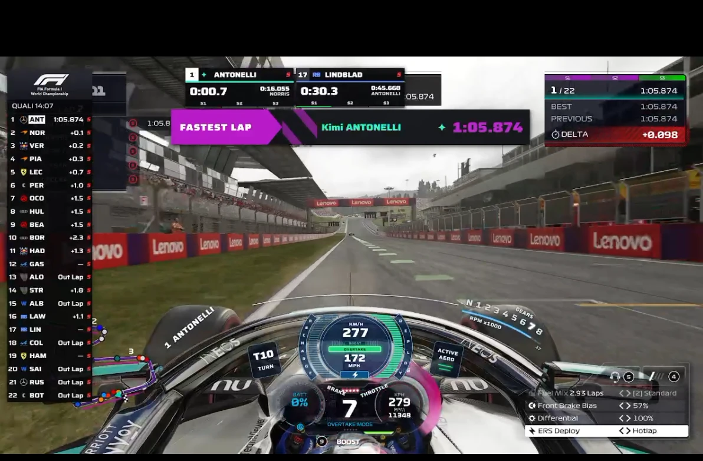
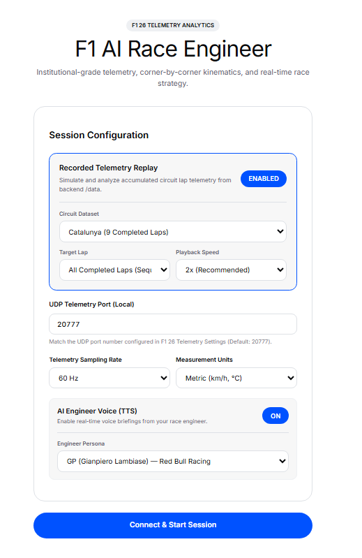
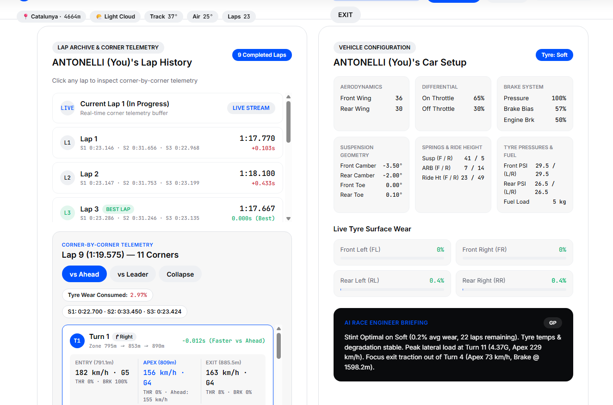
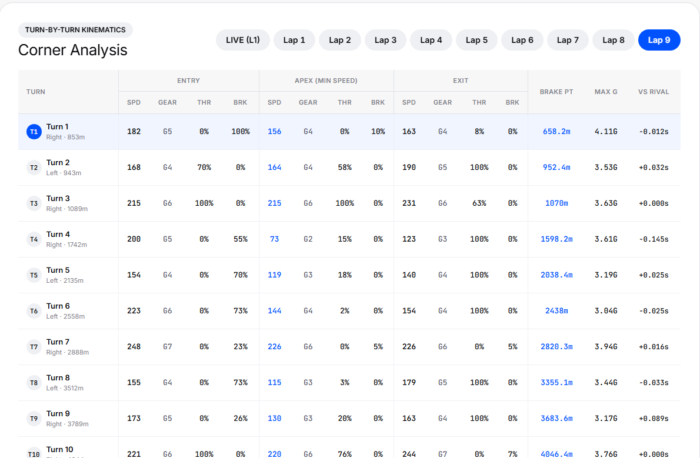
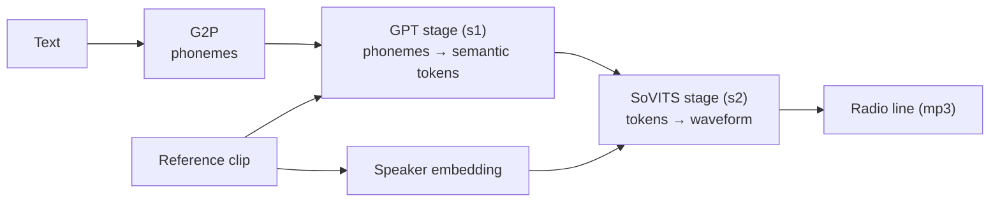

# 🏎️ F1 AI Race Engineer Dashboard

> Real-time telemetry, corner-by-corner analysis, a voiced race engineer and broadcast-style TV graphics for **EA SPORTS™ F1 25 / F1 26**.
>
> 🇰🇷 한국어 안내: [README_ko.md](README_ko.md)


<sub>TV overlay drawn over the game: timing tower, live lap cards, fastest-lap banner, lap/delta panel and the halo HUD (speed, gear, pedals, ERS, turn number).</sub>

## ✨ What it does
* **Live dashboard** — reads the game's UDP telemetry (port `20777`, 60 Hz): lap and sector times, tyre wear and temperatures, setup, and a turn-by-turn table (entry/apex/exit speed, gear, pedals, braking point, G) against the car ahead and the leader.
* **AI race engineer** — pre-recorded radio calls on braking, pace, tyres, pit window and the gap ahead, plus setup advice in practice. You can also ask questions ("Where am I losing time?") and get a voice + text answer.
* **TV overlay** — broadcast graphics drawn transparently over the game: timing tower, lap cards, flags, fastest-lap banner and a halo HUD.
* **Corner maps for 24 tracks** — every current calendar track; open **🗺 Corner Map** on the setup screen to see them.
* **Replay** — play back your recorded sessions without the game.

## 🚀 Quick start
Tested on Windows 11, Python 3.12, F1 25. The built UI is included, so you don't need Node.js unless you use the TV overlay.

```bash
pip install -r project/requirements.txt
python project/run_app.py
```

Your browser opens at `http://localhost:8080`. Add `--no-browser` (or set `F1_NO_BROWSER=1`) to stop it opening.

**Game settings (Settings → Telemetry):** UDP Telemetry **On** · Broadcast Mode Off · IP `127.0.0.1` · Port `20777` · Send Rate 60 Hz.

**App setup screen:**
1. Turn **OFF** "Recorded Telemetry Replay" (on by default).
2. Keep **AI engineer voice briefing (TTS)** ON.
3. Click **Connect & Start Session**, then start a Practice, Qualifying or Race session in the game. Keep **Auto Radio** ON.

## 🎧 Engineer radio
The session type is detected from the game. Calls are at least 6 s apart.

| Call | When | P | Q | R |
|---|---|:-:|:-:|:-:|
| Radio check | Session start or change | ✅ | ✅ | ✅ |
| Lap debrief — *"That lap was zero point four seconds off your best. Turn seven is where we lost the most time. You were late on the brakes there."* | After a clean lap, 150–1200 m into the next one, against your best lap. **Practice:** only when the lap lost ≥ 0.4 s (or ≥ 0.3 s in one sector); a new best adds your timesheet position. **Qualifying:** every push lap: how far off your best, the sector and the turn that cost the time and why (late / early braking, minimum speed, exit), and *"focus on that one"* when the same turn costs time again | ✅ | ✅ | |
| Pace strong / pace drop | Last lap 0.2–1.0 s faster, or 0.45–1.0 s slower; a slower lap names the turn that cost the time and why | | | ✅ |
| Pace drop + box | Last lap ≥ 1.0 s slower | | | ✅ |
| Gap ahead | Once per lap, when the gap is under 10 s | | | ✅ |
| Pit window / box | Any tyre ≥ 38 % worn → window; ≥ 45 % → box this lap | | | ✅ |
| Tyre degradation | Wear ≥ 5 %/lap (≥ 10 % critical), per compound | ✅ | | ✅ |
| Setup advice | From lap 3, at most one call a lap: tyre temperatures and wear first, then the comparison with the fastest car (downforce, balance, traction) ([setup guide](project/docs/SETUP_GUIDE.md)) | ✅ | | |
| Long-run tyre life | Every 3 laps on a set (3+ laps old): wear per lap and how many laps the set would last | ✅ | | |
| Race brief | Before the start: track temperature, weather and the setup change for them | | | ✅ |
| Tyre wear per lap / strategy | Once a lap; a strategy call when the tyres will not reach the pit window | | | ✅ |

* Laps with a safety car, VSC or pit stop are left out of pace and setup comparisons.
* **Ask the engineer** (radio panel): how to win, catching the car ahead, where you lose time, tyres, when to pit, setup, gaps. Ask in Korean or English; the race-only questions answer only during a race.
* Every line the engineer can say: [ENGINEER_VOICE_LINES.md](project/docs/ENGINEER_VOICE_LINES.md) (Korean).

## 📺 TV overlay
Based on [f1-25-tv-overlay](https://github.com/thenotrealuser/f1-25-tv-overlay) (MIT), included in `project/overlay/`.

1. Install **Node.js 18+** and set the game to **borderless / windowed fullscreen**.
2. It is **on by default** and appears as soon as the game sends telemetry. Turn it on or off with the **📺 TV Overlay** card on the setup screen or the **📺 TV** button in the dashboard. The overlay window (Electron, ~370 MB) is downloaded only when you click **Install**.
3. Hotkeys: **Ctrl+Alt+H** show/hide · **Ctrl+Alt+E** edit layout · **Ctrl+Alt+A** fit the halo to your car · Ctrl+Alt+T/L/G/F tower / lap card / halo / flags. Settings: `http://127.0.0.1:8090/control`.
4. The halo HUD is made for the TV-pod camera and fits itself to each team's car the first time. Official logos and fonts are not included; drop your own into `project/overlay/local-assets/`.

The game sends UDP to one port only, so the app receives on 20777 and forwards every packet to the overlay on 20778. Replays feed the overlay too.

## ⏪ Replay
* After driving live, turn on "Recorded Telemetry Replay" and pick **circuit → session → lap**. The app suggests the most recently recorded circuit that is still on disk.
* Recordings (`project/backend/data/circuit_<track>/lap*.jsonl`, ~200 MB per session) are not in the repository, so record your own first.
* Recordings are **deleted automatically**: the earlier session's when a new session starts, and all of them when the app closes. To keep them, send `POST http://localhost:8080/api/recordings` with `{"keep": true}`.

## ⚠️ Known limitations
* Braking calls need a corner map: reverse layouts (Silverstone / Austria / Zandvoort) and Madrid have none yet. A few flat-out kinks are unmapped (Jeddah T22–26, Baku T15/T20, Las Vegas T11).
* Setup advice uses general F1-game rules of thumb. Check your lap time after changing the setup.
* A race lap slowed ≥ 1 s by traffic can still trigger a box call.
* New radio lines need the fine-tuned voice model and GPT-SoVITS, which are not in the repository. All existing voice files are included.

## 📸 Screenshots

| Session setup & replay | Lap archive & corner telemetry |
| :---: | :---: |
|  |  |
| **Turn-by-turn matrix** | **Circuit map & sectors** |
|  |  |

## 🎙️ Engineer voice (GPT-SoVITS few-shot fine-tuning)
The voice is **[GPT-SoVITS](https://github.com/RVC-Boss/GPT-SoVITS) v2ProPlus**, fine-tuned on **3 min 36 s** of the target voice. Every line is generated in advance, so the game never shares the GPU with a TTS model; the app only picks and plays the right file.



* **Fine-tuning:** 44 sentences of 3–10 s (transcribed with Whisper) → SoVITS 12 epochs (timbre), GPT 10 epochs (delivery). It takes a few minutes on an RTX 3070 8 GB.
* **Quality check:** each line is generated up to 6–12 times, transcribed back with Whisper, and the take closest to the script is kept (average match 0.92).
* **Output:** 39 fixed calls + 219 number-specific sentences (braking 1–40 m, gaps 0.2–9.9 s, pace drops 1–5 s), recorded as whole sentences rather than stitched clips.
* Tried and dropped: Coqui XTTS-v2 (low similarity), Fish Audio S2 Pro (needs 16–24 GB VRAM).
* The full work log is in [project/README.md](project/README.md).

## 💻 Development
```bash
cd project/backend && python main.py --no-browser   # API + WebSocket on :8080
cd project/frontend && npm install && npm run dev   # UI with hot reload on :5173
```

Docs: [data & rendering guide](project/docs/DATA_AND_RENDERING_GUIDE.md) · [setup guide](project/docs/SETUP_GUIDE.md) · [engineer voice lines](project/docs/ENGINEER_VOICE_LINES.md)
