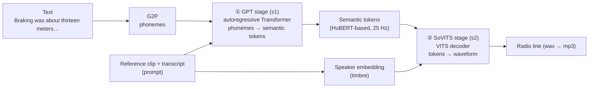

# 🏎️ F1 AI Race Engineer Dashboard

> **Institutional-grade telemetry, corner-by-corner kinematics, and real-time race strategy for F1 25 / F1 26.**

A high-performance web dashboard that captures real-time high-speed UDP telemetry (port `20777`) from EA SPORTS™ F1 25 / F1 26, analyzing turn-by-turn kinematics, tire degradation, and circuit telemetry to provide drivers with professional pitwall-grade engineering insights.

Built with the Coinbase Design System aesthetic—combining a deep dark hero band, crisp white editorial canvas, soft surface elevations, and tabular `JetBrains Mono` typography for high data density and readability.

---

## 📸 Screenshots

| 1. Session Configuration & Replay | 2. Lap Archive & Corner Telemetry |
| :---: | :---: |
|  |  |
| Replay circuit selection, 60Hz UDP port, AI voice persona | Multi-lap history, corner entry/apex/exit metrics, setup & wear |

| 3. Turn-by-Turn Kinematics Matrix | 4. Interactive Circuit Map & Sectors |
| :---: | :---: |
|  |  |
| Full corner table (T1~TN) with speed, gear, pedals, brake point, G-force | Vector racing line, clickable dynamic apex markers, split timing |

---

## ✨ Key Features

### 1. Advanced Session Configuration & Replay
* **Live & Replay Modes**: Stream live from the game at 60Hz or replay pre-recorded telemetry files (Catalunya 9 Laps, Austria, etc.) at 1x to 4x playback speed.
* **i18n & Unit Conversion**: Real-time switching between English (ENG) / Korean (KOR) and Metric (km/h, °C) / Imperial (mph, °F).
* **AI Engineer Persona**: Select your race engineer voice persona (GP for Max Verstappen, Bono for Lewis Hamilton, Ricky for Carlos Sainz).

### 2. High-Fidelity Packet Parsing & Kinematics Engine
* **Full C-Struct Parsing**: `Packet 0` (Motion), `Packet 1` (Session), `Packet 2` (Lap Data), `Packet 4` (Participants), `Packet 5` (Car Setups), `Packet 6` (Car Telemetry), `Packet 10` (Car Damage), `Packet 11` (Session History).
* **Turn-by-Turn Telemetry & Kinematics**:
  * Entry, Apex, and Exit speeds (`km/h`), gear selection, throttle %, and brake %.
  * Precise Braking Point (`m`) detection and Throttle-On (`m`) re-application point.
  * Lateral G-load (`Max G`) and live rival comparison (`vs Ahead` / `vs Leader`).

### 3. Interactive Multi-Lap History
* Click any completed lap (`Lap 1` through `Lap 9`) or `LIVE` buffer to inspect turn-by-turn telemetry cards.
* Official millisecond lap and sector times (`S1, S2, S3`) directly parsed from `SessionHistory`.

### 4. Interactive Circuit Map
* Smooth SVG vector racing line generated from high-density circuit coordinates.
* Interactive corner markers (`T1 ~ T11`) tracking the driver's dynamic apex (actual minimum speed location) per lap.
* Click any corner on the map to inspect its telemetry profile.

---

## 🎙️ AI Race Engineer Voice (GPT-SoVITS few-shot fine-tuning)

The engineer's radio calls are generated by **[GPT-SoVITS](https://github.com/RVC-Boss/GPT-SoVITS) v2ProPlus**, fine-tuned on about **3 min 36 s** of the target voice. So the game never has to share the GPU with a TTS model, every radio line is **pre-baked** offline and the app only picks and plays the right file.

### Models
| Role | Model |
|---|---|
| Text-to-speech | GPT-SoVITS **v2ProPlus** — pretrained weights from `lj1995/GPT-SoVITS` (`s1v3.ckpt`, `v2Pro/s2Gv2ProPlus.pth`, `s2Dv2ProPlus.pth`) |
| Speech features | `chinese-hubert-base` (HuBERT self-supervised speech representation) |
| Speaker embedding | `sv/pretrained_eres2netv2w24s4ep4.ckpt` (ERes2NetV2 speaker-verification model, used by v2Pro) |
| Transcription & QA | faster-whisper `small.en` |

### How it works
GPT-SoVITS splits speech generation into **what to say and how** and **whose voice says it**.



1. **G2P:** text becomes phonemes. Numbers are spelled out first (`13` → *thirteen*, `0.8` → *zero point eight*).
2. **GPT stage (s1, Text2Semantic):** given the phonemes and a reference prompt, it predicts a sequence of **semantic tokens** — quantised HuBERT speech features at 25 Hz, a "blueprint" of the speech. This stage decides **pronunciation, intonation and pacing**.
3. **SoVITS stage (s2):** turns the semantic tokens into a waveform and applies the **timbre** from the speaker embedding.

### Few-shot fine-tuning
Training starts from models already trained on thousands of hours of speech, and only **nudges their weights** toward the target voice. The model already knows how to speak; it just learns this voice, so a few minutes of audio is enough.

1. **Dataset:** 9 reference clips (3 min 36 s) → sliced on silence into 44 sentences of 3–10 s → transcribed with Whisper. Clips recorded from a known script use the **script text** instead of Whisper's guesses.
2. **Features:** phonemes, HuBERT semantic tokens and speaker embeddings are precomputed for every sentence.
3. **SoVITS fine-tune (12 epochs):** learns the voice's **timbre and texture** (semantic tokens → waveform).
4. **GPT fine-tune (15 epochs, epoch-10 weights used):** learns the speaker's **delivery and intonation**. With this little data, epoch 15 overfit and pronunciation got less stable, so epoch 10 is used.

Training takes a few minutes on an RTX 3070 8 GB.

### Generation & quality control
* **Sampling:** `temperature 0.6` and `top_k 5` for stability, `speed 0.9` (10 % slower than the source).
* **Whisper check:** each line is generated up to 6–12 times; every take is transcribed back with Whisper and the take that **best matches the script** is kept (average match 0.92).
* **Output:** 39 fixed radio calls + 219 number-specific full sentences = **258 files**. Braking 1–40 m, gaps 0.2–9.9 s and pace drops 1.0–5.0 s are baked as whole sentences, so they sound more natural than stitched prefix + number + suffix clips.

### Tried and dropped
* **Coqui XTTS-v2 (zero-shot cloning):** low voice similarity, and noise after short phrases.
* **Fish Audio S2 Pro:** needs 16–24 GB VRAM; won't run on an RTX 3070 8 GB.

> The full work log (dataset, hyper-parameters, regeneration commands) is in the ["Engineer voice generation log" section of project/README.md](project/README.md).

---

## 💻 Quick Start

### 1. Backend
```bash
cd project/backend
# Activate your python virtual environment
python main.py
```
* Runs at `http://localhost:8080`. With the pre-parsed disk cache (`_parsed_laps_cache_v3.json`), server startup and lap preloading take only ~28ms.

### 2. Frontend
```bash
cd project/frontend
npm install
npm run dev
```
* Open your browser at `http://localhost:5173`.

---

## 📖 Documentation
* [Data Structure & Rendering Architecture Guide](project/docs/DATA_AND_RENDERING_GUIDE.md)
* [Coinbase Design System Specification](project/frontend/DESIGN-coinbase.md)
