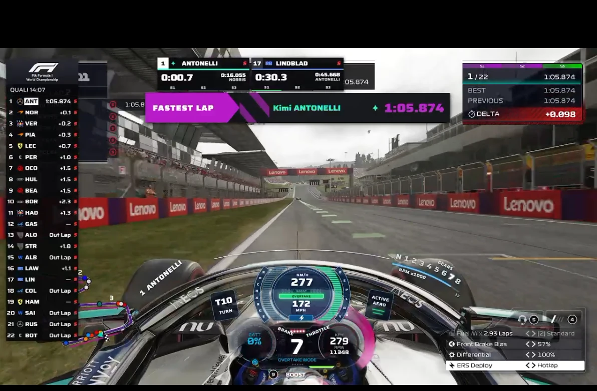
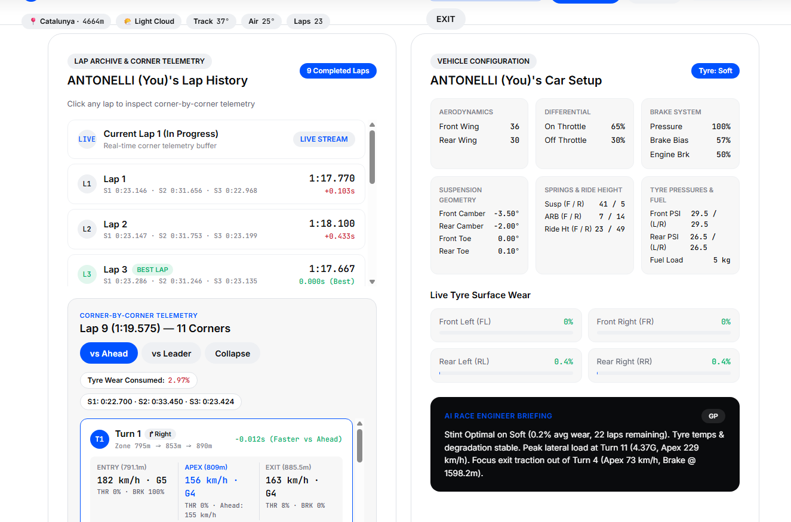
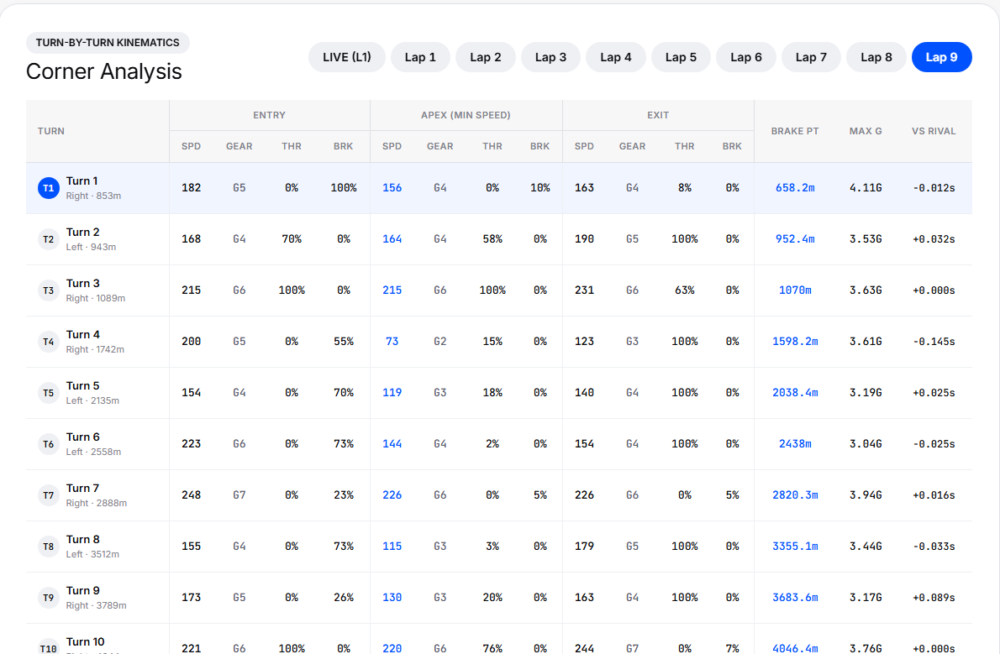
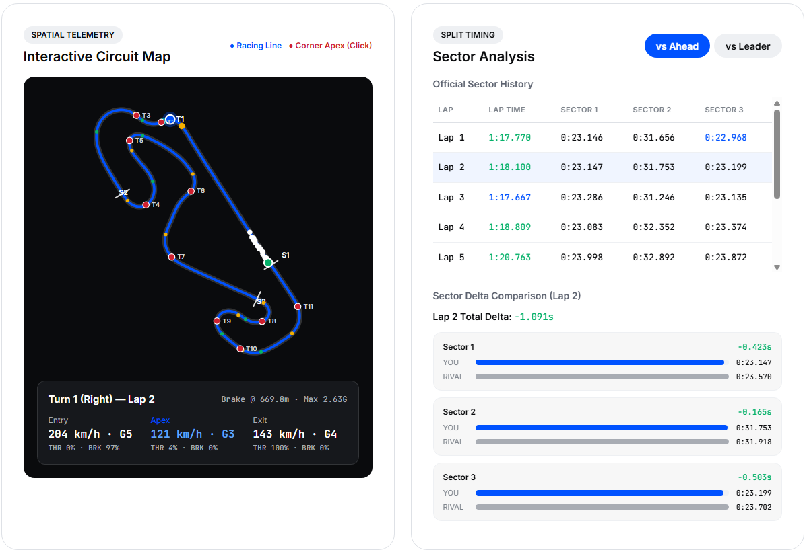
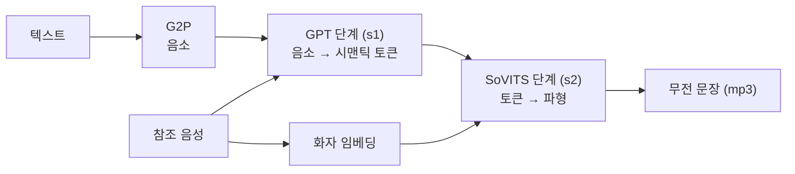

# 🏎️ F1 AI Race Engineer Dashboard

> **EA SPORTS™ F1 25 / F1 26**용 실시간 텔레메트리, 코너별 분석, 음성 레이스 엔지니어, 중계 스타일 TV 그래픽.
>
> 🇺🇸 English: [README.md](README.md)


<sub>게임 화면 위에 띄운 TV 오버레이: 타이밍 타워, 실시간 랩 카드, 패스티스트 랩 배너, 랩·델타 패널, 할로 HUD(속도, 기어, 페달, ERS, 코너 번호).</sub>

## ✨ 주요 기능
* **실시간 대시보드** — 게임의 UDP 텔레메트리(포트 `20777`, 60Hz)를 받아 랩·섹터 기록, 타이어 마모·온도, 셋업, 코너별 표(진입·에이펙스·탈출 속도, 기어, 페달, 브레이킹 지점, G)를 보여 주고 앞차·선두와 비교해요.
* **AI 레이스 엔지니어** — 브레이킹, 페이스, 타이어, 피트 윈도우, 앞차 갭을 미리 녹음한 무전으로 알려 주고, 프랙티스에서는 셋업도 조언해요. "어디서 시간을 잃고 있어?"처럼 물어보면 음성과 글로 답해요.
* **TV 오버레이** — 타이밍 타워, 랩 카드, 깃발, 패스티스트 랩 배너, 할로 HUD를 게임 화면 위에 투명하게 띄워요.
* **24개 트랙 코너 맵** — 현재 캘린더 전체. 설정 화면의 **🗺 Corner Map** 버튼으로 볼 수 있어요.
* **리플레이** — 녹화한 세션을 게임 없이 다시 재생해요.

## 🚀 빠른 시작
테스트 환경: Windows 11, Python 3.12, F1 25. 빌드된 화면이 포함돼 있어서 TV 오버레이를 쓰지 않으면 Node.js는 필요 없어요.

```bash
pip install -r project/requirements.txt
python project/run_app.py
```

브라우저가 `http://localhost:8080`으로 열려요. 열지 않으려면 `--no-browser`를 붙이거나 `F1_NO_BROWSER=1`을 설정하세요.

**게임 설정 (설정 → 텔레메트리):** UDP Telemetry **On** · Broadcast Mode Off · IP `127.0.0.1` · Port `20777` · Send Rate 60Hz.

**앱 설정 화면:**
1. **"Raw Data 리플레이 모드"를 끕니다**(기본값은 켜짐).
2. **AI 엔지니어 음성 브리핑(TTS)** 은 켜 둡니다.
3. **"세션 연결 및 시작"** 을 누르고 게임에서 Practice / Qualifying / Race 세션에 들어가요. 무전 패널의 **"자동 무전 브리핑"** 은 켜 둡니다.

## 🎧 엔지니어 무전
세션 종류는 게임 데이터로 자동 구분돼요. 무전 사이에는 최소 6초 간격을 둬요.

| 무전 | 나오는 조건 | P | Q | R |
|---|---|:-:|:-:|:-:|
| Radio check | 세션 시작 또는 세션이 바뀔 때 | ✅ | ✅ | ✅ |
| 랩 디브리프 — *"That lap was zero point four seconds off your best. Turn seven is where we lost the most time. You were late on the brakes there."* | 깨끗한 랩을 마친 뒤 다음 랩 150~1200m에서, 내 베스트 랩과 비교해요. **프랙티스:** 랩에서 0.4초 이상(또는 한 섹터에서 0.3초 이상) 잃었을 때만 말하고, 베스트 랩이면 타임시트 순위를 알려줘요. **퀄리파잉:** 푸시 랩마다 베스트보다 몇 초 느렸는지, 어느 섹터·코너에서 왜 잃었는지(브레이킹 늦음/이름, 코너 최저 속도, 탈출) 알려주고, 같은 코너가 또 문제면 *"그 코너에 집중하세요"*라고 해요 | ✅ | ✅ | |
| 페이스 좋음 / 하락 | 직전 랩이 0.2~1.0초 빠르거나 0.45~1.0초 느릴 때. 느려졌으면 시간을 잃은 코너와 원인을 말해요 | | | ✅ |
| 페이스 급락 + 박스 | 직전 랩이 1초 이상 느릴 때 | | | ✅ |
| 앞차 갭 | 랩마다 한 번, 갭이 10초 미만일 때 | | | ✅ |
| 피트 윈도우 / 박스 | 타이어 하나라도 마모 38% 이상이면 윈도우 오픈, 45% 이상이면 박스 | | | ✅ |
| 타이어 마모율 | 랩당 5% 이상(10% 이상은 위험), 컴파운드별 문장 | ✅ | | ✅ |
| 셋업 조언 | 3랩부터, 랩당 최대 1회. 타이어 온도·마모를 먼저 보고, 그다음 가장 빠른 차와 비교(다운포스·밸런스·트랙션)해요([셋업 가이드](project/docs/SETUP_GUIDE.md)) | ✅ | | |
| 롱런 타이어 수명 | 같은 세트로 3랩 이상 달렸을 때 3랩마다: 랩당 마모율과 이 세트가 몇 랩 버티는지 | ✅ | | |
| 레이스 전 브리핑 | 출발 전: 트랙 온도·날씨와 그에 맞는 셋업 변경 | | | ✅ |
| 랩당 타이어 마모 / 전략 | 랩마다 1회, 피트 윈도우까지 타이어가 못 버틸 것 같으면 전략 무전 | | | ✅ |

* 세이프티카·VSC가 나왔거나 피트인한 랩은 페이스·셋업 비교에서 빠져요.
* **엔지니어에게 질문**(무전 패널): 1등 하는 법, 앞차 추격, 시간을 잃는 곳, 타이어, 피트 시점, 셋업, 갭. 한국어·영어 모두 되고, 레이스 전용 질문은 레이스 세션에서만 답해요.
* 엔지니어가 하는 모든 문장: [ENGINEER_VOICE_LINES.md](project/docs/ENGINEER_VOICE_LINES.md)

## 📺 TV 오버레이
[f1-25-tv-overlay](https://github.com/thenotrealuser/f1-25-tv-overlay)(MIT)를 바탕으로 `project/overlay/`에 포함했어요.

1. **Node.js 18 이상**을 설치하고, 게임 디스플레이 모드를 **테두리 없는 창(창 모드 전체 화면)** 으로 바꿉니다.
2. **기본이 켜짐**이라 게임이 텔레메트리를 보내면 바로 나타나요. 설정 화면의 **📺 TV 오버레이** 카드나 대시보드의 **📺 TV** 버튼으로 켜고 꺼요. 오버레이 창(Electron, 약 370MB)은 **설치**를 눌렀을 때만 내려받아요.
3. 단축키: **Ctrl+Alt+H** 표시/숨김 · **Ctrl+Alt+E** 배치 편집 · **Ctrl+Alt+A** 할로 자동 맞춤 · Ctrl+Alt+T/L/G/F 타워 / 랩 카드 / 할로 / 깃발. 세부 설정: `http://127.0.0.1:8090/control`.
4. 할로 HUD는 TV-pod 카메라 기준이고, 팀마다 처음 주행할 때 차 위치에 자동으로 맞춰져요. 공식 로고·폰트는 포함돼 있지 않아서 `project/overlay/local-assets/`에 직접 넣으면 적용돼요.

게임은 UDP를 한 포트로만 보낼 수 있어서, 앱이 20777로 받은 패킷을 오버레이(20778)로 그대로 넘겨줘요. 리플레이도 오버레이에 표시돼요.

## ⏪ 리플레이
* 실시간으로 한 번 주행한 뒤 "Raw Data 리플레이 모드"를 켜고 **서킷 → 세션 → 랩**을 고르세요. 디스크에 남아 있는 서킷 중 가장 최근에 녹화한 곳이 기본으로 잡혀요.
* 녹화 파일(`project/backend/data/circuit_<트랙>/lap*.jsonl`, 세션당 약 200MB)은 저장소에 없으니 먼저 직접 녹화해야 해요.
* 녹화는 **자동으로 지워져요**: 새 세션이 시작되면 이전 세션 녹화를, 앱을 끄면 전부 지워요. 남기려면 `POST http://localhost:8080/api/recordings`에 `{"keep": true}`를 보내세요.

## ⚠️ 알아둘 점
* 브레이킹 무전은 코너 맵이 있어야 나와요. 역방향 레이아웃(Silverstone·Austria·Zandvoort)과 Madrid는 아직 없고, 전개로 지나가는 일부 코너는 매핑되지 않았어요(Jeddah T22~26, Baku T15·T20, Las Vegas T11).
* 셋업 조언은 F1 게임 셋업 경험칙이에요. 바꾼 뒤에는 랩타임으로 확인하세요.
* 트래픽 때문에 1초 이상 느려진 레이스 랩에서도 박스 지시가 나올 수 있어요.
* 새 무전 문장을 만들려면 파인튜닝한 음성 모델과 GPT-SoVITS가 필요한데, 저장소에는 없어요. 지금 있는 음성 파일은 모두 포함돼 있어요.

## 📸 스크린샷

| 세션 설정 · 리플레이 | 랩 기록 · 코너 텔레메트리 |
| :---: | :---: |
|  |  |
| **코너별 분석 표** | **서킷 맵 · 섹터** |
|  |  |

## 🎙️ 엔지니어 음성 (GPT-SoVITS 퓨샷 파인튜닝)
엔지니어 목소리는 **[GPT-SoVITS](https://github.com/RVC-Boss/GPT-SoVITS) v2ProPlus**를 목표 음성 **3분 36초**로 파인튜닝해서 만들었어요. 모든 문장을 미리 생성해 두기 때문에 게임과 TTS 모델이 GPU를 나눠 쓰지 않고, 앱은 맞는 파일을 골라 재생만 해요.



* **파인튜닝:** 3~10초 문장 44개(Whisper로 받아쓰기) → SoVITS 12 에폭(음색), GPT 10 에폭(말투). RTX 3070 8GB에서 몇 분이면 끝나요.
* **품질 검사:** 문장마다 6~12번 생성하고 Whisper로 다시 받아써서 대본과 가장 가까운 것을 골라요(평균 일치도 0.92).
* **결과:** 고정 무전 39개 + 숫자별 문장 219개(브레이킹 1~40m, 갭 0.2~9.9초, 페이스 하락 1~5초). 조각을 이어 붙이지 않고 문장 전체로 생성했어요.
* 써 보고 뺀 것: Coqui XTTS-v2(목소리 유사도 낮음), Fish Audio S2 Pro(VRAM 16~24GB 필요).
* 전체 작업 기록은 [project/README.md](project/README.md)에 있어요.

## 💻 개발
```bash
cd project/backend && python main.py --no-browser   # API + WebSocket, :8080
cd project/frontend && npm install && npm run dev   # 핫 리로드 화면, :5173
```

문서: [데이터 · 렌더링 가이드](project/docs/DATA_AND_RENDERING_GUIDE.md) · [셋업 가이드](project/docs/SETUP_GUIDE.md) · [엔지니어 무전 문구](project/docs/ENGINEER_VOICE_LINES.md)
