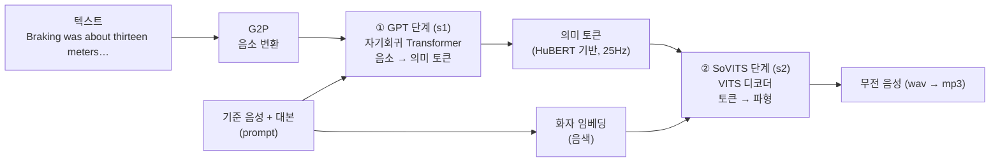

# 🏎️ F1 AI Race Engineer Dashboard

> **F1 25 / F1 26 게임을 위한 실시간 텔레메트리, 코너별 기구학 분석 및 레이스 전략 대시보드**

본 프로젝트는 F1 25 / F1 26 게임의 UDP 텔레메트리 데이터를 실시간으로 수집·분석하여, 드라이버에게 레이스 엔지니어 수준의 통찰과 코너별 주행 비교 데이터를 제공하는 웹 애플리케이션입니다.

Coinbase Design System을 적용하여 가독성과 전문성을 높였으며, 실시간 주행 모드와 사전 녹화된 세션 리플레이 모드를 모두 지원합니다.

---

## 📸 대시보드 화면 안내

| 1. 세션 환경 설정 (Session Configuration) | 2. 랩 히스토리 & 코너 텔레메트리 (Lap & Telemetry) |
| :---: | :---: |
|  |  |
| 리플레이 서킷/배속 선택, 60Hz UDP 포트, AI 보이스 페르소나 설정 | 전 랩 멀티 셀렉션, 코너별 진입/정점/탈출 상세 지표, 차량 셋업 및 타이어 마모도 |

| 3. 코너별 주행 매트릭스 (Corner Analysis) | 4. 인터랙티브 서킷 맵 & 섹터 (Circuit Map) |
| :---: | :---: |
|  |  |
| 서킷 전 코너(T1~TN)의 속도·기어·페달·브레이킹 포인트·횡G 비교 | SVG 기반 실제 레이싱 라인, 클릭 가능한 코너 에이펙스 마커, 섹터 스플릿 타임 |

---

## ✨ 핵심 기능 (Key Features)

### 1. 강력한 사용자 맞춤형 셋업 (Session Configuration)
* **다국어 및 단위계 지원**: 한국어(KOR) / 영어(ENG), Metric(km/h, °C) / Imperial(mph, °F) 실시간 전환.
* **통신 주파수 및 녹화 리플레이**: 30Hz / 60Hz 선택, Catalunya 9 Laps 등 녹화본 1x ~ 4x 리플레이 재생.
* **AI 엔지니어 페르소나**: GP(막스 베르스타펜), Bono(루이스 해밀턴), Ricky(카를로스 사인츠) 등 전담 엔지니어 선택.

### 2. 정밀한 패킷 파싱 및 물리 역산 파이프라인
* **F1 UDP C-Struct 완전 해독**: `Packet 0`(Motion), `Packet 1`(Session), `Packet 2`(Lap Data), `Packet 4`(Participants), `Packet 5`(Car Setups), `Packet 6`(Car Telemetry), `Packet 10`(Car Damage), `Packet 11`(Session History).
* **물리 기반 동적 코너 분석**:
  * 각 코너의 진입(Entry) / 에이펙스(Apex) / 탈출(Exit) 속도, 기어, 스로틀, 브레이크 계산.
  * 브레이킹 시작 지점(`Brake Point`, m), 스로틀 전개 지점(`Throttle On`, m), 최대 횡가속도(`Max G`) 산출.
  * 앞차(`vs Ahead`) 및 선두(`vs Leader`) 대비 코너 최저속도 및 시간 득실 실시간 비교.

### 3. 멀티 랩 히스토리 및 코너별 상세 뷰
* `Lap 1`부터 `Lap 9` 또는 `LIVE` 중 원하는 랩을 언제든 클릭하여 해당 랩의 코너별 상세 카드 그리드 열람.
* 공식 섹터 타임(`S1, S2, S3`) 및 베스트 랩 대비 델타 타임 표시.

### 4. 인터랙티브 서킷 맵 & 섹터 분석
* 서킷 레퍼런스 라인(수천 개의 정밀 좌표)을 기반으로 한 벡터 트랙 렌더링.
* 코너별 에이펙스 마커(`T1 ~ T11`)가 매 랩 드라이버의 실제 최저 속도 통과 지점(Dynamic Apex)에 맞춰 연동.
* 코너 마커 클릭 시 해당 코너의 구체적인 주행 텔레메트리 팝업 표시.

---

## 🎙️ AI 레이스 엔지니어 보이스 (GPT-SoVITS 퓨샷 파인튜닝)

대시보드의 엔지니어 무전은 **[GPT-SoVITS](https://github.com/RVC-Boss/GPT-SoVITS) v2ProPlus** 모델을 원하는 목소리 약 **3분 36초** 분량으로 미세조정(few-shot fine-tuning)해서 만들었습니다. 게임과 GPU를 나눠 쓰지 않도록, 무전 문장은 전부 **미리 생성(pre-bake)** 해 두고 앱은 상황에 맞는 파일을 골라 재생만 합니다.

### 사용 모델
| 역할 | 모델 |
|---|---|
| 음성 합성 (TTS) | GPT-SoVITS **v2ProPlus** — 사전학습 가중치 `lj1995/GPT-SoVITS` (`s1v3.ckpt`, `v2Pro/s2Gv2ProPlus.pth`, `s2Dv2ProPlus.pth`) |
| 음성 특징 추출 | `chinese-hubert-base` (HuBERT 자기지도 음성 표현) |
| 화자 임베딩 | `sv/pretrained_eres2netv2w24s4ep4.ckpt` (ERes2NetV2 화자 인식 모델, v2Pro 계열 전용) |
| 받아쓰기 · 품질 검사 | faster-whisper `small.en` |

### 동작 원리
GPT-SoVITS는 "**무엇을 어떻게 말할지**"와 "**누구 목소리로 낼지**"를 두 단계로 나눠 처리합니다.



1. **G2P:** 문장을 음소 기호로 바꿉니다. 숫자는 미리 단어로 풀어 씁니다(`13` → *thirteen*, `0.8` → *zero point eight*).
2. **GPT 단계 (s1, Text2Semantic):** 음소와 기준 음성(prompt)을 보고 **의미 토큰** 시퀀스를 하나씩 예측합니다. 의미 토큰은 HuBERT 음성 특징을 양자화한 25Hz 단위의 "말소리 설계도"예요. 이 단계가 **발음·억양·말 빠르기**를 결정합니다.
3. **SoVITS 단계 (s2):** 의미 토큰을 실제 파형으로 바꿉니다. 이때 화자 임베딩으로 **음색(목소리 색깔)** 을 입힙니다.

### 퓨샷 파인튜닝은 어떻게 했나
수천 시간의 음성으로 미리 학습된 모델에서 출발해서, 목표 목소리 몇 분으로 **가중치를 살짝 조정**하는 방식입니다. 처음부터 학습하는 게 아니라 이미 "말하는 법"을 아는 모델을 이 목소리에 맞추는 것이라, 소량의 데이터로도 충분합니다.

1. **데이터 준비:** 레퍼런스 음성 9개(3분 36초) → 무음 기준으로 3~10초 문장 44개로 자르기 → Whisper로 받아쓰기. 대본을 알고 있는 녹음은 Whisper 오인식 대신 **대본 원문**으로 교체.
2. **특징 추출:** 문장마다 음소, HuBERT 의미 토큰, 화자 임베딩을 미리 계산.
3. **SoVITS 미세조정 (12 epoch):** 의미 토큰 → 파형 변환을 이 목소리에 맞춰 **음색과 질감**을 학습.
4. **GPT 미세조정 (15 epoch, 10 epoch 결과 사용):** 이 사람의 **말투와 억양**을 학습. 데이터가 적어서 15 epoch는 과학습으로 발음이 불안정해졌고, 10 epoch 모델이 가장 좋았습니다.

학습은 RTX 3070 8GB에서 몇 분이면 끝납니다.

### 생성과 품질 관리
* **생성 설정:** `temperature 0.6`, `top_k 5`로 무작위성을 낮추고, `speed 0.9`로 10% 느리게 생성.
* **Whisper 검증:** 문장마다 최대 6~12번 생성한 뒤, 결과를 Whisper로 다시 받아 적어 **원문과 가장 일치하는 take**를 채택(평균 일치율 0.92).
* **생성 대상:** 고정 무전 39개 + 숫자별 통문장 219개 = **258개 파일**. 브레이킹 1~40m, 갭 0.2~9.9초, 페이스 하락 1.0~5.0초를 문장째로 미리 만들어 두어서, 조각을 이어 붙일 때보다 억양이 자연스럽습니다.

### 시도했다가 버린 방식
* **Coqui XTTS-v2 (학습 없는 음성 복제):** 목소리 유사도가 낮고 짧은 문장 뒤에 잡음이 붙음.
* **Fish Audio S2 Pro:** VRAM 16~24GB가 필요해 RTX 3070 8GB에서 실행 불가.

> 학습 데이터, 하이퍼파라미터, 재생성 명령 등 전체 작업 로그는 [project/README.md의 "엔지니어 보이스 생성 작업 로그"](project/README.md) 섹션에 있습니다.

---

## 💻 빠른 실행 (Quick Start)

### 1. 백엔드 실행
```bash
cd project/backend
# 가상환경 활성화 후
python main.py
```
* 서버는 `http://localhost:8080`에서 실행되며, 사전 파싱된 서킷 캐시(`_parsed_laps_cache_v3.json`) 덕분에 약 28ms 만에 즉시 기동됩니다.

### 2. 프론트엔드 실행
```bash
cd project/frontend
npm install
npm run dev
```
* 브라우저에서 `http://localhost:5173`으로 접속합니다.

---

## 📖 문서 가이드
* [상세 데이터 구조 및 렌더링 가이드](project/docs/DATA_AND_RENDERING_GUIDE.md)
* [Coinbase 디자인 시스템 명세](project/frontend/DESIGN-coinbase.md)
