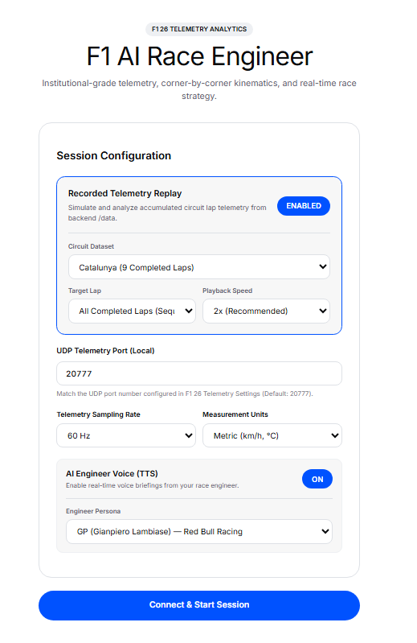
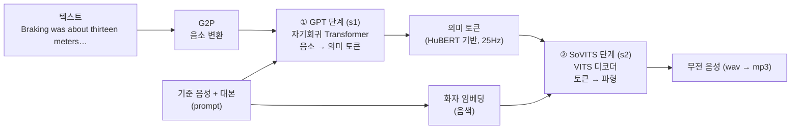

# 🏎️ F1 AI Race Engineer Dashboard

> **F1 25 / F1 26 게임을 위한 실시간 텔레메트리, 코너별 기구학 분석 및 레이스 전략 대시보드**

## 🚀 실행 방법 (실시간 레이스 + 엔지니어 무전)

### 1. 설치 · 실행
테스트 환경: Windows 11, Python 3.12, EA SPORTS™ F1 25. Node.js는 필요 없어요(빌드된 화면 `project/frontend/dist` 포함).

```bash
pip install -r project/requirements.txt
```

```bash
python project/run_app.py
```

서버가 뜨면 브라우저가 `http://localhost:8080`으로 자동으로 열립니다(`python project/backend/main.py`도 동일). 열지 않으려면 `--no-browser`를 붙이거나 `F1_NO_BROWSER=1`을 설정하세요.

### 2. 게임 설정 (설정 → 텔레메트리)
| 항목 | 값 |
|---|---|
| UDP Telemetry | **On** |
| UDP Broadcast Mode | Off |
| UDP IP Address | `127.0.0.1` |
| UDP Port | `20777` |
| UDP Send Rate | 60Hz (권장) |

### 3. 앱 설정 화면
1. **"Raw Data 리플레이 모드"를 끕니다.** 기본값은 켜짐이라, 켜 두면 녹화 데이터를 재생해요.
2. **AI 엔지니어 음성 브리핑(TTS)** 은 **ON**으로 둡니다(기본값).
3. **"세션 연결 및 시작"** 을 누른 뒤 게임에서 Practice / Qualifying / Race 아무 세션에나 들어가면 됩니다.
4. 대시보드 무전 패널의 **"자동 무전 브리핑"** 도 **ON**인지 확인합니다(기본값).

### 4. 엔지니어 무전이 나오는 순간
세션 종류(Practice / Qualifying / Race)는 게임 데이터(`m_sessionType`)로 자동 구분되고, 상단에 `🏁 Race` 같은 배지로 표시됩니다.

| 무전 | 나오는 조건 | Practice | Quali | Race |
|---|---|:-:|:-:|:-:|
| **Radio check** | 세션 시작 직후. 세션이 바뀌면 다시 나옴 | ✅ | ✅ | ✅ |
| **코너 브레이킹** *"Braking was about 13 meters early on entry."* | **2랩부터**. 코너 출구(+15m)를 지날 때 이번 랩 브레이킹 지점을 이 세션 최고 랩과 비교. Practice·Quali는 5~45m, Race는 10~45m 차이일 때 | ✅ | ✅ | ✅ |
| **페이스 좋음** *"Pace is very strong…"* | **3랩부터**. 직전 랩이 그 전 랩보다 0.2~1.0초 빠를 때 | ✅ | ✅ | ✅ |
| **페이스 하락** *"Pace dropped by roughly half a second…"* | 직전 랩이 0.45~1.0초 느릴 때 | ✅ | ✅ | ✅ |
| **페이스 급락 + 박스** *"Pace dropped by 1.3 seconds… box this lap!"* | 직전 랩이 1초 이상 느릴 때 | — | — | ✅ |
| **앞차 갭** *"Gap to car ahead is 0.8 seconds, DRS available."* | 랩마다 한 번, 출발선 뒤 150~600m 구간에서 갭이 10초 미만일 때 | — | — | ✅ |
| **피트 윈도우 / 박스** | 타이어 하나라도 마모 38% 이상이면 윈도우 오픈, 45% 이상이면 박스 지시(세션당 각 1회) | — | — | ✅ |
| **트랙션** *"Exit traction was down…"* | 지난 랩 최저 코너 탈출 속도가 110km/h 미만일 때(세션당 1회) | ✅ | — | ✅ |
| **타이어 마모율** *"Soft tyre degradation is high, over five percent per lap…"* | 직전 랩 마모율이 랩당 5% 이상(10% 이상이면 위험 경고). 컴파운드별 문장 | ✅ | — | ✅ |
| **셋업 조언** *"The car is front limited. Try two clicks more front wing…"* | **3랩부터**. 최근 2랩의 타이어 온도·마모로 판단([셋업 가이드](project/docs/SETUP_GUIDE.md)). 메인 스트레이트에서, 같은 조언은 4랩에 한 번 | ✅ | — | — |

* 무전 사이에는 **최소 6초** 간격을 둬요. 그 사이 지나간 코너는 건너뜁니다.
* 첫 랩에는 비교할 기준 랩이 없어서 브레이킹 무전이 나오지 않습니다.
* **세이프티카·VSC가 나왔거나 피트인한 랩**은 페이스 비교와 셋업 판단에서 빠집니다(잘못된 "box this lap" 방지).
* 셋업 조언은 대시보드 무전 패널에 **현재 값 → 추천 값**(예: `Front wing 36 → 38`)과 판단 근거(평균 타이어 온도, 랩당 마모율)가 함께 표시돼요.

### 4-1. 엔지니어에게 질문하기
대시보드 무전 패널의 **"🎧 엔지니어에게 질문"** 에서 버튼을 누르거나 직접 입력하면, 그 순간의 데이터로 계산해서 **음성 + 글(영어·한국어) + 근거 수치**로 답해요.

| 질문 예시 (한국어 / 영어 둘 다 됨) | 엔지니어 답변 내용 |
|---|---|
| **1등 하려면 어떻게 해야 해?** / How can I win? | 선두와의 갭, 남은 랩 수로 계산한 **랩당 필요한 시간**, 가장 많이 잃는 섹터. 랩당 3초 넘게 필요하면 "앞차부터 한 계단씩" |
| **앞차 잡을 수 있어?** / Can I catch the car ahead? | 앞차 갭, 랩당 좁히는(벌어지는) 속도, **DRS 거리까지 몇 랩**, 앞차에게 가장 많이 잃는 섹터, 타이어 나이 비교에 따른 팁 |
| **어디서 시간을 잃고 있어?** / Where am I losing time? | 지난 랩 vs 베스트 랩의 섹터별 손실, **가장 크게 잃은 코너와 브레이킹 차이** |
| **타이어 상태 어때?** / How are my tyres? | 가장 많이 닳은 타이어 마모율, 온도 상태(적정 / 앞 과열 / 뒤 과열 / 저온) |
| **언제 피트인 해야 해?** / When should I pit? | 랩당 마모율로 계산한 **마모 45%까지 남은 랩** → "N랩 뒤 박스" 또는 "끝까지 간다" |
| **셋업 어떻게 바꿔야 해?** / Any setup changes? | [셋업 가이드](project/docs/SETUP_GUIDE.md) 규칙에 따른 조언 + 현재 값 → 추천 값 |
| **갭 알려줘** / What's the gap? | 앞차 갭과 선두 갭 |

* 키워드로 의도를 알아들어요(예: "앞차", "추월", "catch" → 앞차 추격 질문). 모르는 질문에는 *"Say again…"* 으로 답합니다.
* 1등, 앞차, 피트, 갭 질문은 Race 세션 전용이에요. 다른 세션에서는 *"That one is for the race…"* 로 답합니다.
* 답변 음성은 모두 미리 생성한 문장(숫자별 포함)을 이어서 재생합니다. TTS가 꺼져 있으면 글로만 보여 줘요.

### 4-2. TV 오버레이 (게임 위 중계 그래픽)
[f1-25-tv-overlay](https://github.com/thenotrealuser/f1-25-tv-overlay)(MIT)를 `project/overlay/`에 포함했어요. 타이밍 타워, 예선 탈락권, 랩 카드(S1/S2 실시간), 온보드 카드, 계기판(속도·기어·RPM·ERS), 깃발·SC/VSC, 패스티스트 랩 배너를 게임 화면 위에 투명하게 띄웁니다.

1. **Node.js 18 이상**을 설치합니다([nodejs.org](https://nodejs.org)).
2. 게임 그래픽 설정에서 디스플레이 모드를 **"창 모드(전체 화면)"(테두리 없는 창)** 으로 바꿉니다. 독점 전체 화면에서는 위에 띄울 수 없어요.
3. **따로 할 일 없음 — 기본이 ON이에요.** 앱이 켜지는 순간부터 게임 데이터를 기다리고, **게임이 텔레메트리를 보내는 순간 오버레이가 자동으로 나타나요**(대시보드를 열지 않아도 되고, 그 전에는 아무것도 표시되지 않아요). 켜고 끄는 스위치는 하나예요 — 설정 화면의 **"📺 TV 오버레이"** 카드, 또는 대시보드 상단 **📺 TV** 버튼. 선택은 다음 실행에도 기억돼요.
   * 버튼 상태: `TV OFF` · `TV 대기 ●`(켜짐, 게임 데이터 기다리는 중) · `TV 시작 중…` · `TV ON ●`(실시간 표시 중) · `TV 설치` / `설치 중…` · `TV 오류`(마우스를 올리면 이유 표시).
   * 오버레이 창(Electron, 약 370MB)은 **`TV 설치`(또는 설정 카드의 "설치")를 눌렀을 때 한 번만** 내려받아요. 자동으로 받지 않아요.
   * 주행 데이터 녹화(`lap*.jsonl`)는 실시간 대시보드가 열려 있을 때만 해요. 오버레이만 켜져 있을 때는 녹화하지 않아요.
4. 단축키: **Ctrl+Alt+H** 전체 표시/숨김, **Ctrl+Alt+E** 배치 편집 모드(요소를 마우스로 옮기기), Ctrl+Alt+T 타워, Ctrl+Alt+L 랩 카드, Ctrl+Alt+G 계기판, Ctrl+Alt+F 깃발.
5. 세부 설정 화면: `http://127.0.0.1:8090/control`
6. 디자인: 기본은 **중계 화면 기준으로 맞춘 테마**(`project/overlay/theme-broadcast.css`)예요. 타워 위치·크기·행 높이를 실제 게임 중계 오버레이 화면에 픽셀 단위로 맞췄고, 글꼴은 중계 글꼴과 가장 비슷한 무료 폰트 **Saira(폭 118%)** 를 써요. 공식 로고·폰트·팀 로고는 저장소에 없고, **`project/overlay/local-assets/`에 직접 넣으면 자동 적용**돼요(파일 이름 규칙은 그 폴더의 README). 원본 디자인은 `http://127.0.0.1:8090/?theme=original`.
7. **TV-pod 할로 HUD** (게임의 가운데 TV-pod 카메라 기준): overlay를 켜면 **자동으로 표시**돼요(게임이 카메라 종류를 알려주지 않아서 직접 켜 둡니다. Ctrl+Alt+G로 숨김). 속도 계기판이 화면(헤일로) 가운데에 오고, 브레이크(왼쪽)·스로틀(오른쪽)은 계기판을 감싸는 원호 게이지예요. 표시되는 값은 모두 텔레메트리에서 옵니다 — 속도, 기어, 브레이크/스로틀, ERS 배터리, Boost·Overtake·Active Aero 상태(2026 패킷 16), 내 차와 앞차 이름, **차량 최대 RPM 기준 RPM 바**, 그리고 **공식 코너 번호**. 우리 앱의 24개 트랙 코너 데이터를 시작할 때 `project/overlay/curvas/`에 넣어 주기 때문에, 학습 랩 없이 첫 랩부터 TURN 번호가 나와요. 카메라 위치가 조금 다르면 편집 모드나 `/control`에서 할로 전체를 옮기거나 크기를 바꾸면 됩니다.

**동작 방식:** 게임은 UDP를 한 곳에만 보낼 수 있어서, 우리 앱이 20777로 받은 패킷을 **그대로 overlay(20778)로 넘겨줍니다.** overlay 화면 서버는 8090 포트를 써요(우리 대시보드 8080과 겹치지 않게). **리플레이 모드에서도** 녹화 데이터를 원래 바이너리 패킷으로 다시 만들어 보내기 때문에, 게임 없이도 overlay를 볼 수 있어요. 대시보드에서 EXIT를 눌러도 스위치가 ON이면 overlay는 계속 떠 있고, 스위치를 OFF로 하거나 앱을 끄면 꺼집니다.

### 5. 알아둘 점 (현재 한계)
* **코너 브레이킹 무전과 "가장 크게 잃은 코너" 답변은 코너 맵이 있는 24개 트랙**(현재 캘린더 전체)에서 나와요. 코너 맵이 아직 없는 역방향 레이아웃(Silverstone·Austria·Zandvoort Reverse)과 Madrid에서는 자동으로 꺼집니다. 전개로 지나가는 일부 코너는 매핑되지 않았어요(Jeddah T22~26, Baku T15·T20, Las Vegas T11).
* 셋업 조언 기준값은 F1 게임 셋업 경험칙이에요([셋업 가이드](project/docs/SETUP_GUIDE.md)). 적용한 뒤에는 랩타임으로 확인하세요.
* 트래픽 때문에 1초 이상 느려진 랩에는 레이스에서 박스 지시가 나올 수 있어요(세이프티카·피트인 랩은 제외됨).
* 실시간 모드에서는 주행 데이터가 `project/backend/data/circuit_<트랙>/lap*.jsonl`에 기록됩니다(랩당 약 100MB). 이 데이터가 리플레이에 쓰여요.

### 6. 리플레이 모드
* 실시간 모드로 한 번 주행하면 녹화 데이터가 쌓이고, 이후 "Raw Data 리플레이 모드"를 켜서 **서킷 → 세션(Practice 1 / Race #1 …) → 랩**을 골라 다시 볼 수 있어요.
* 녹화 원본(`*.jsonl`)은 용량 때문에 저장소에 올라가 있지 않아요. **저장소를 새로 받은 PC에서는 직접 주행해서 녹화한 뒤에** 리플레이를 쓸 수 있습니다.

### 7. 저장소를 받은 사람이 쓸 수 있는 것
| 기능 | 가능 여부 |
|---|---|
| 실시간 대시보드 + 엔지니어 무전 + 질문하기 | ✅ 위 1~3단계만 하면 됨(무전·답변 음성 639개 포함) |
| 리플레이 | 직접 녹화한 뒤 가능 |
| TV 오버레이 | ✅ Node.js 18 이상 필요(처음 켤 때 Electron 자동 설치) |
| 새 무전 문장 생성 | ❌ 파인튜닝 모델과 GPT-SoVITS 환경이 필요해요(저장소 미포함). 아래 [AI 레이스 엔지니어 보이스](#️-ai-레이스-엔지니어-보이스-gpt-sovits-퓨샷-파인튜닝) 참고 |

---

본 프로젝트는 F1 25 / F1 26 게임의 UDP 텔레메트리 데이터를 실시간으로 수집·분석하여, 드라이버에게 레이스 엔지니어 수준의 통찰과 코너별 주행 비교 데이터를 제공하는 웹 애플리케이션입니다.

Coinbase Design System을 적용하여 가독성과 전문성을 높였으며, 실시간 주행 모드와 사전 녹화된 세션 리플레이 모드를 모두 지원합니다.

---

## 📸 대시보드 화면 안내

| 1. 세션 환경 설정 (Session Configuration) | 2. 랩 히스토리 & 코너 텔레메트리 (Lap & Telemetry) |
| :---: | :---: |
|  |  |
| 리플레이 서킷/배속 선택, 60Hz UDP 포트, AI 보이스 페르소나 설정 | 전 랩 멀티 셀렉션, 코너별 진입/정점/탈출 상세 지표, 차량 셋업 및 타이어 마모도 |

| 3. 코너별 주행 매트릭스 (Corner Analysis) | 4. 인터랙티브 서킷 맵 & 섹터 (Circuit Map) |
| :---: | :---: |
|  |  |
| 서킷 전 코너(T1~TN)의 속도·기어·페달·브레이킹 포인트·횡G 비교 | SVG 기반 실제 레이싱 라인, 클릭 가능한 코너 에이펙스 마커, 섹터 스플릿 타임 |

---

## ✨ 핵심 기능 (Key Features)

### 1. 강력한 사용자 맞춤형 셋업 (Session Configuration)
* **다국어 및 단위계 지원**: 한국어(KOR) / 영어(ENG), Metric(km/h, °C) / Imperial(mph, °F) 실시간 전환.
* **통신 주파수 및 녹화 리플레이**: 30Hz / 60Hz 선택, Catalunya 9 Laps 등 녹화본 1x ~ 4x 리플레이 재생.
* **AI 엔지니어 페르소나**: GP(막스 베르스타펜), Bono(루이스 해밀턴), Ricky(카를로스 사인츠) 등 전담 엔지니어 선택.

### 2. 정밀한 패킷 파싱 및 물리 역산 파이프라인
* **F1 UDP C-Struct 완전 해독**: `Packet 0`(Motion), `Packet 1`(Session), `Packet 2`(Lap Data), `Packet 4`(Participants), `Packet 5`(Car Setups), `Packet 6`(Car Telemetry), `Packet 10`(Car Damage), `Packet 11`(Session History).
* **물리 기반 동적 코너 분석**:
  * 각 코너의 진입(Entry) / 에이펙스(Apex) / 탈출(Exit) 속도, 기어, 스로틀, 브레이크 계산.
  * 브레이킹 시작 지점(`Brake Point`, m), 스로틀 전개 지점(`Throttle On`, m), 최대 횡가속도(`Max G`) 산출.
  * 앞차(`vs Ahead`) 및 선두(`vs Leader`) 대비 코너 최저속도 및 시간 득실 실시간 비교.

### 3. 멀티 랩 히스토리 및 코너별 상세 뷰
* `Lap 1`부터 `Lap 9` 또는 `LIVE` 중 원하는 랩을 언제든 클릭하여 해당 랩의 코너별 상세 카드 그리드 열람.
* 공식 섹터 타임(`S1, S2, S3`) 및 베스트 랩 대비 델타 타임 표시.

### 4. 인터랙티브 서킷 맵 & 섹터 분석
* 서킷 레퍼런스 라인(수천 개의 정밀 좌표)을 기반으로 한 벡터 트랙 렌더링.
* 코너별 에이펙스 마커(`T1 ~ T11`)가 매 랩 드라이버의 실제 최저 속도 통과 지점(Dynamic Apex)에 맞춰 연동.
* 코너 마커 클릭 시 해당 코너의 구체적인 주행 텔레메트리 팝업 표시.

---

## 🎙️ AI 레이스 엔지니어 보이스 (GPT-SoVITS 퓨샷 파인튜닝)

대시보드의 엔지니어 무전은 **[GPT-SoVITS](https://github.com/RVC-Boss/GPT-SoVITS) v2ProPlus** 모델을 원하는 목소리 약 **3분 36초** 분량으로 미세조정(few-shot fine-tuning)해서 만들었습니다. 게임과 GPU를 나눠 쓰지 않도록, 무전 문장은 전부 **미리 생성(pre-bake)** 해 두고 앱은 상황에 맞는 파일을 골라 재생만 합니다.

### 사용 모델
| 역할 | 모델 |
|---|---|
| 음성 합성 (TTS) | GPT-SoVITS **v2ProPlus** — 사전학습 가중치 `lj1995/GPT-SoVITS` (`s1v3.ckpt`, `v2Pro/s2Gv2ProPlus.pth`, `s2Dv2ProPlus.pth`) |
| 음성 특징 추출 | `chinese-hubert-base` (HuBERT 자기지도 음성 표현) |
| 화자 임베딩 | `sv/pretrained_eres2netv2w24s4ep4.ckpt` (ERes2NetV2 화자 인식 모델, v2Pro 계열 전용) |
| 받아쓰기 · 품질 검사 | faster-whisper `small.en` |

### 동작 원리
GPT-SoVITS는 "**무엇을 어떻게 말할지**"와 "**누구 목소리로 낼지**"를 두 단계로 나눠 처리합니다.



1. **G2P:** 문장을 음소 기호로 바꿉니다. 숫자는 미리 단어로 풀어 씁니다(`13` → *thirteen*, `0.8` → *zero point eight*).
2. **GPT 단계 (s1, Text2Semantic):** 음소와 기준 음성(prompt)을 보고 **의미 토큰** 시퀀스를 하나씩 예측합니다. 의미 토큰은 HuBERT 음성 특징을 양자화한 25Hz 단위의 "말소리 설계도"예요. 이 단계가 **발음·억양·말 빠르기**를 결정합니다.
3. **SoVITS 단계 (s2):** 의미 토큰을 실제 파형으로 바꿉니다. 이때 화자 임베딩으로 **음색(목소리 색깔)** 을 입힙니다.

### 퓨샷 파인튜닝은 어떻게 했나
수천 시간의 음성으로 미리 학습된 모델에서 출발해서, 목표 목소리 몇 분으로 **가중치를 살짝 조정**하는 방식입니다. 처음부터 학습하는 게 아니라 이미 "말하는 법"을 아는 모델을 이 목소리에 맞추는 것이라, 소량의 데이터로도 충분합니다.

1. **데이터 준비:** 레퍼런스 음성 9개(3분 36초) → 무음 기준으로 3~10초 문장 44개로 자르기 → Whisper로 받아쓰기. 대본을 알고 있는 녹음은 Whisper 오인식 대신 **대본 원문**으로 교체.
2. **특징 추출:** 문장마다 음소, HuBERT 의미 토큰, 화자 임베딩을 미리 계산.
3. **SoVITS 미세조정 (12 epoch):** 의미 토큰 → 파형 변환을 이 목소리에 맞춰 **음색과 질감**을 학습.
4. **GPT 미세조정 (15 epoch, 10 epoch 결과 사용):** 이 사람의 **말투와 억양**을 학습. 데이터가 적어서 15 epoch는 과학습으로 발음이 불안정해졌고, 10 epoch 모델이 가장 좋았습니다.

학습은 RTX 3070 8GB에서 몇 분이면 끝납니다.

### 생성과 품질 관리
* **생성 설정:** `temperature 0.6`, `top_k 5`로 무작위성을 낮추고, `speed 0.9`로 10% 느리게 생성.
* **Whisper 검증:** 문장마다 최대 6~12번 생성한 뒤, 결과를 Whisper로 다시 받아 적어 **원문과 가장 일치하는 take**를 채택(평균 일치율 0.92).
* **생성 대상:** 고정 무전 39개 + 숫자별 통문장 219개 = **258개 파일**. 브레이킹 1~40m, 갭 0.2~9.9초, 페이스 하락 1.0~5.0초를 문장째로 미리 만들어 두어서, 조각을 이어 붙일 때보다 억양이 자연스럽습니다.

### 시도했다가 버린 방식
* **Coqui XTTS-v2 (학습 없는 음성 복제):** 목소리 유사도가 낮고 짧은 문장 뒤에 잡음이 붙음.
* **Fish Audio S2 Pro:** VRAM 16~24GB가 필요해 RTX 3070 8GB에서 실행 불가.

> 학습 데이터, 하이퍼파라미터, 재생성 명령 등 전체 작업 로그는 [project/README.md의 "엔지니어 보이스 생성 작업 로그"](project/README.md) 섹션에 있습니다.

---

## 💻 개발 모드 실행 (코드 수정 시)

> 일반 사용은 맨 위 [실행 방법](#-실행-방법-실시간-레이스--엔지니어-무전)을 보세요.

### 1. 백엔드 실행
```bash
cd project/backend
# 가상환경 활성화 후
python main.py --no-browser
```
* 서버는 `http://localhost:8080`에서 실행됩니다. `--no-browser` 없이 실행하면 빌드된 UI가 브라우저로 열리니, 아래 Vite 개발 서버로 작업할 때는 붙여 두세요. 사전 파싱된 서킷 캐시(`_parsed_laps_cache_v3.json`) 덕분에 약 28ms 만에 즉시 기동됩니다.

### 2. 프론트엔드 실행
```bash
cd project/frontend
npm install
npm run dev
```
* 브라우저에서 `http://localhost:5173`으로 접속합니다.

---

## 📖 문서 가이드
* [상세 데이터 구조 및 렌더링 가이드](project/docs/DATA_AND_RENDERING_GUIDE.md)
* [Coinbase 디자인 시스템 명세](project/frontend/DESIGN-coinbase.md)
