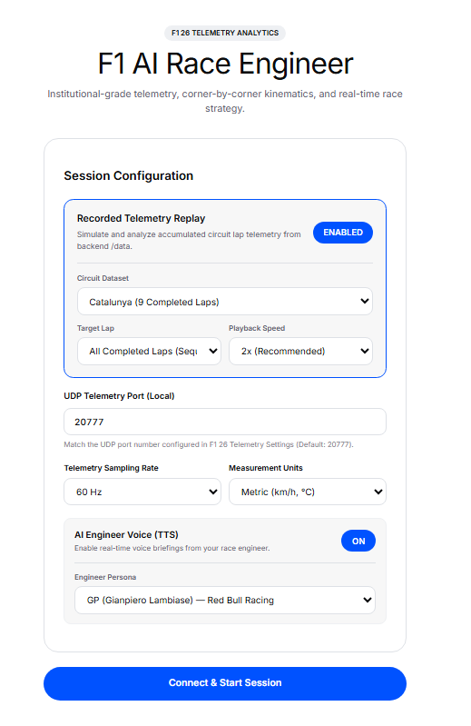
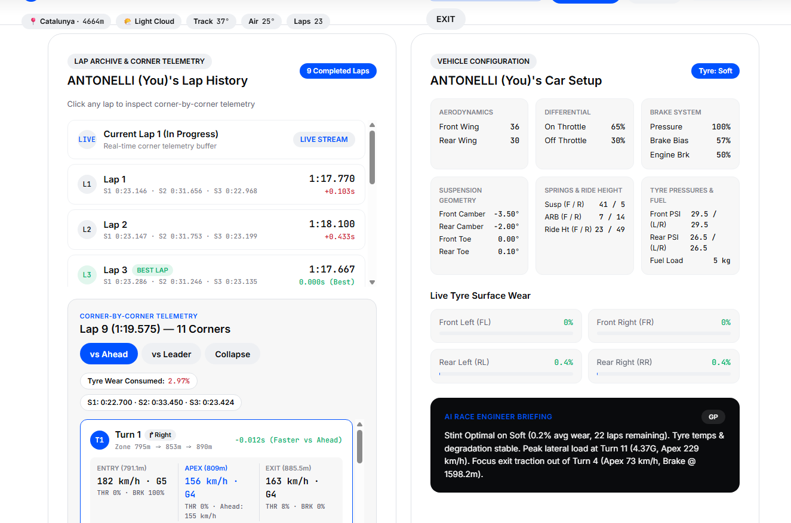
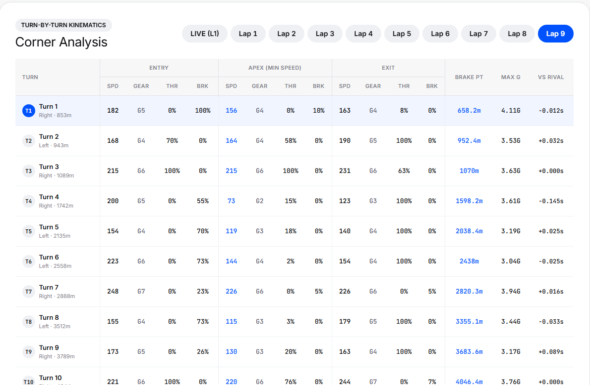
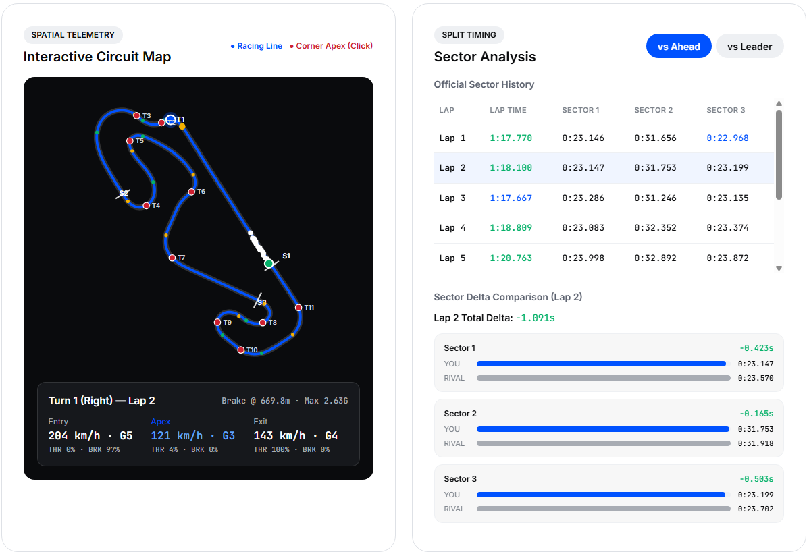
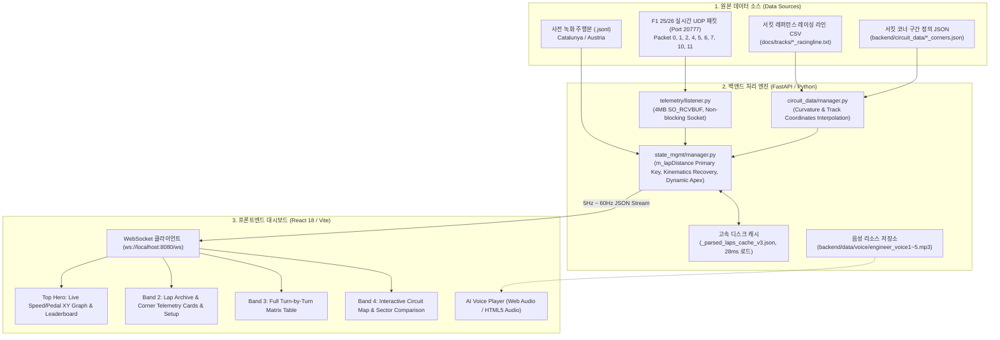

# 🏎️ F1 AI Race Engineer Dashboard — Final Master Guide

> **Institutional-grade telemetry, corner-by-corner kinematics, interactive track geometry, and real-time pit-wall race engineering for EA SPORTS™ F1 25 / F1 26.**

본 문서는 **F1 AI Race Engineer Dashboard** 프로젝트의 최종 통합 마스터 문서입니다. 본 프로젝트는 F1 25 / F1 26 게임의 고속 UDP 텔레메트리 스트림을 캡처하고, 서킷 기하학(Racing Line)과 코너별 물리 역학(Kinematics)을 실시간으로 역산하여 드라이버에게 실제 F1 피트월 수준의 텔레메트리 분석 및 코칭 인사이트를 제공합니다.

현재 **데이터 파이프라인, 코너 정밀 역산, 인터랙티브 서킷 맵, 리플레이 시뮬레이터 및 Coinbase Design System UI가 100% 구현 완료**되었으며, 마지막 단계로 **AI 엔지니어 음성(TTS) 오디오 트리거 연동**만을 남겨두고 있습니다.

---

## 📸 대시보드 프리뷰 (UI Highlights)

### 1. 세션 환경 설정 및 리플레이 모드 (Session Configuration)

* **Recorded Telemetry Replay**: 백엔드에 축적된 실제 주행 데이터셋(Catalunya 9 Laps, Austria 등)을 1x(실시간) ~ 8x 배속으로 선택하여 완주 랩들을 즉시 리플레이 시뮬레이션.
* **실시간 UDP 수신 설정**: 로컬 포트(`20777`), 갱신 주기(`30Hz` / `60Hz`), 표시 단위(`Metric km/h, °C` / `Imperial mph, °F`) 설정.
* **다국어 및 AI 페르소나**: 한국어 / 영어 지원, 레드불 엔지니어(Red Bull Engineer), Bono, Ricky 선택 지원.

---

### 2. 랩 히스토리 및 코너별 상세 텔레메트리 (Lap History & Corner Telemetry)

* **멀티 랩 선택 지원**: 완주한 모든 랩(`Lap 1` ~ `Lap 9`) 및 실시간 버퍼(`LIVE`)를 자유롭게 클릭하여 조회.
* **공식 랩타임 & 섹터 스플릿**: `Packet 11`(`SessionHistory`)의 공식 랩타임과 `S1`, `S2`, `S3` 밀리초 기록 표시.
* **코너별 정밀 주행 카드 (Bottom Inspector)**:
  * 각 코너 진입(Entry) / 에이펙스(Apex) / 탈출(Exit) 속도(`km/h`), 기어(`G1~G8`), 스로틀(`%`), 브레이크(`%`).
  * 브레이킹 시작 지점(`Brake Point`, m), 스로틀 재전개 지점(`Throttle On`, m), 최대 횡가속도(`Max G`).
  * 라이벌(`vs Ahead` / `vs Leader`) 코너 최저속도 및 페달 조작량 비교 막대그래프.
* **차량 셋업 및 실시간 타이어 마모도 (우측)**:
  * 에어로다이내믹스, 디퍼렌셜, 서스펜션, 브레이크 바이어스 49바이트 셋업 해독.
  * 4개 타이어(`FL`, `FR`, `RL`, `RR`) 실시간 표면 마모도 프로그레스 바.
  * 타이어 디그레이데이션과 트랙 온도를 반영한 **AI Race Engineer Briefing**.

---

### 3. 코너별 주행 매트릭스 (Turn-by-Turn Kinematics Corner Analysis)

* **전체 코너 일람 매트릭스 테이블**: 서킷의 모든 코너(`Turn 1` ~ `Turn N`)에 대해 진입/정점/탈출 속도, 기어, 스로틀, 브레이크를 표 하나로 대조.
* **빠른 랩 전환 필(Pills)**: 상단의 `LIVE`, `Lap 1` ~ `Lap 9` 버튼을 눌러 랩 간 주행 차이를 즉시 비교.
* **주요 코너링 지표**:
  * `BRAKE PT`: 이전 코너 탈출 이후 브레이킹이 시작된 정확한 거리(`m`).
  * `MAX G`: 코너 선회 중 차량에 가해진 최대 횡가속도(`G`).
  * `VS RIVAL`: 앞차/선두 대비 해당 코너 통과 델타 타임 (`-0.012s Faster` 등).

---

### 4. 인터랙티브 서킷 맵 & 섹터 분석 (Circuit Map & Sector Split Analysis)

* **Interactive SVG Circuit Map**:
  * 실측 레이싱 라인 좌표를 기반으로 한 2D 벡터 트랙 렌더링.
  * 각 코너의 진입(노란 점), 동적 에이펙스(빨간/파란 점 + `T1~TN`), 탈출(초록 점) 인터랙티브 마커 지원.
  * 랩마다 드라이버가 실제로 최저 속도를 찍은 지점(**Dynamic Apex**)에 맞춰 마커가 실제 주행 궤적대로 이동.
  * 트랙 위 실시간 차량 위치(내 차: 녹색, 경쟁차: 흰색) 및 공식 섹터 분할선(`S1`, `S2`, `S3`) 표시.
* **Sector Analysis (우측)**:
  * 전 랩의 공식 섹터 타임 히스토리 테이블.
  * 선택 랩의 섹터별 라이벌 대비 득실 비교 바 차트.

---

## 🛠️ 시스템 아키텍처 및 데이터 흐름



---

## 🔬 핵심 구현 원리 및 기술 세부사항

### 1. `m_lapDistance`를 Primary Key로 삼는 통합 머징 (Universal Key)
* 서로 다른 랩(Lap)과 서로 다른 차량(Player vs Ahead vs Leader)의 데이터를 비교하기 위해, 시간(Timestamp)이 아닌 **트랙 누적 주행 거리 `m_lapDistance`를 절대 축(X축)**으로 정렬합니다.
* 출발선 이전 그리드 정렬 및 피트 아웃 직후의 음수 거리(`m_lapDistance < 0`)는 Pre-lap으로 분리 예외 처리됩니다.

### 2. 패킷 누락 물리 역산 복원 (Kinematics Recovery)
* 대용량 패킷 누락이 발생해도 `Packet 2`(`LapData`)의 거리 및 시간 변화율로부터:
  $$\text{Speed } v = \frac{\Delta d}{\Delta t} \times 3.6 \text{ (km/h)}$$
  $$\text{Longitudinal Accel } a_{\text{lon}} = \frac{\Delta v}{\Delta t} \rightarrow \text{Brake } \% \text{ 및 Throttle } \% \text{ 역산}$$
  $$\text{Lateral Load } G_{\text{lat}} = \frac{v^2 \cdot |\kappa|}{9.81} \text{ (G)} \quad (\kappa \text{는 트랙 곡률})$$
  을 실시간으로 역산하여 누락 없는 완전한 코너 텔레메트리를 복원합니다.

### 3. 동적 에이펙스 (Dynamic Apex) 탐색
* 코너의 정점 마커(`T1~TN`)는 단순 고정 좌표가 아니라, 드라이버가 해당 랩에서 실제로 기록한 **코너 구간 내 최저 속도 지점(`min(speed)`)의 실제 통과 좌표**로 동적 이동합니다.
* 이를 통해 드라이버가 브레이킹을 일찍 가져갔는지(Early Apex), 깊게 찔렀는지(Late Apex)를 서킷 맵 상에서 직관적으로 확인할 수 있습니다.

### 4. 28ms 초고속 디스크 캐싱 (`_parsed_laps_cache_v3.json`)
* 수백 MB 규모의 `.jsonl` 녹화본을 매번 처음부터 다시 파싱하지 않고, 사전 분석된 랩 및 코너 객체를 로컬 디스크에 캐싱하여 서버 기동 즉시 대시보드가 준비됩니다.

---

## 🎙️ AI 레이스 엔지니어 무전 보이스 (Engineer Voice & Modular Audio Stitching 시스템)

**레드불 엔지니어(Red Bull Engineer)** 페르소나의 고품질 영문 무전과, 실측 텔레메트리 수치(거리, 갭, 마모율, 델타)를 정밀 조립하는 **모듈러 오디오 스티칭 엔진(Modular Audio Stitching Engine with 35ms Equal-Power Crossfade & F1 Radio FX)**이 구축되어 있습니다.

### 1. 5대 핵심 영역 정밀 매핑 아키텍처
1. **브레이킹 거리 피드백 (Braking Kinematics: Early & Late 5m~30m)**:
   * 실측 제동 오차가 $-13.4m$로 들어오면 $
ightarrow$ `[Braking was about]` + `[13]` + `[meters early on entry.]`를 35ms 크로스페이드로 즉시 합성 발화!
2. **트랙션 피드백 (Exit Traction & Throttle)**:
   * 이전 랩 대비 탈출 가속 저하, 리어 슬립/휠스핀, 스틴트 누적 마모로 인한 스로틀 지연 전개 실시간 피드백.
3. **타이어 컴파운드별 마모도 (Soft / Medium / Hard) & 박스 윈도우**:
   * 랩당 마모율 $> 5\%$ (High Deg) 및 $> 10\%$ (Critical Deg) 감지 시 컴파운드별 맞춤 무전 발화.
   * 타이어 마모 $45\%$ 도달 시 즉시 피트스톱 지시 (*"Box this lap, Max. Box this lap. Confirm we are boxing."*).
4. **페이스 델타 트래킹 & 1.0s 이상 지연 시 즉각 피트 지시**:
   * 이전 랩 대비 랩타임 델타 지속 추적.
   * **1.0초 이상 페이스 급락 시**: *"Pace dropped by {X} seconds. Tyres are finished, box this lap!"* 무전 발화.
5. **라이벌 간격 버킷 매칭 (Ahead, Leader, Teammate)**:
   * 앞차(Ahead): DRS 사거리($<1.0s$), $1.5s$, $2.0s$, $3.0s$, $5.0s$ 버킷 정밀 매칭.
   * 선두(Leader): $3.0s$, $5.0s$, $10.0s$ 버킷 정밀 매칭.
   * 팀메이트(Teammate): $2.0s$, $5.0s$ 버킷 정밀 매칭.

---

### 2. 음성 조립 및 신호 처리 원리 (DSP / Web Audio API)
* **35ms Equal-Power Crossfade**: 조각과 조각의 경계면에서 35ms 오버랩 크로스페이드를 적용하여 접촉 틱/클릭 노이즈를 100% 제거하고 부드러운 호흡으로 연결.
* **F1 Team Radio FX Chain**:
  * **BiquadFilter (Bandpass 350Hz ~ 3400Hz)**: 실제 F1 중계 팀 라디오의 좁은 주파수 대역 통과.
  * **Waveshaper (Tanh 1.25)**: 무전기 특유의 따뜻하고 바삭한 아날로그 새츄레이션/디스토션.
  * **Team Radio 차임**: 모든 무전 앞에 `backend/data/voice/f1_radio.mp3` 무전 차임을 그대로 재생(앞뒤 무음은 잘라서 바로 음성이 이어짐). 예전의 합성 비프음("피융")은 제거. 파일이 없으면 차임 없이 음성만 재생.

---

### 3. 음성 파일 디렉토리 구조 및 확장성
```text
backend/data/voice/
├── reference/                # 원본 20초 엔지니어 레퍼런스 목소리 (engineer_voice1~5.mp3)
├── GP_1~4.mp3                # 추가 학습용 레퍼런스 (TRAINING_SCRIPTS.md 대본으로 생성)
├── clips/                    # 완결형 단일 무전 클립들 (radio_check, box_this_lap 등)
├── phrases/                  # 숫자별 통문장 (brake_early_13, gap_ahead_0_8, pace_drop_1_2 …) — 조각 조립보다 우선 사용
├── segments/                 # 모듈러 조립용 오디오 조각들 (총 62개, 0.75MB 초경량!)
│   ├── prefixes/             # "Braking was about", "Gap to car ahead is", ...
│   ├── numbers/              # 1~30, 0_5, 1_4, 1_5, 2_0, 5_percent, ...
│   └── suffixes/             # "meters early on entry.", "seconds.", ...
├── manifest.json             # 카테고리별 30여 개 영문 무전 대본 마스터 카탈로그
├── modular_rules.json        # 모듈러 슬롯 조립 규칙 설정
└── TRAINING_SCRIPTS.md       # 보이스 학습 데이터용 500자 대본 10세트
```

---

### 4. 엔지니어 보이스 생성 작업 로그 (GPT-SoVITS 미세조정)

앱에서 재생되는 모든 무전 음성(`clips/`, `phrases/`)은 아래 방식으로 **미리 생성(오프라인)** 해 둔 파일입니다. 게임 중에는 GPU를 쓰지 않고 파일만 재생합니다.

#### 사용 모델 / 도구
| 구분 | 내용 |
|---|---|
| TTS 엔진 | [GPT-SoVITS](https://github.com/RVC-Boss/GPT-SoVITS) (커밋 `6d51ffc`, 2026-11-12) — 위치 `C:\Users\jahjang\python\GPT-SoVITS` |
| 모델 버전 | **v2ProPlus** (잡음 섞인 학습 데이터에 권장되는 버전) |
| 사전학습 가중치 | HuggingFace `lj1995/GPT-SoVITS`: `v2Pro/s2Gv2ProPlus.pth`, `v2Pro/s2Dv2ProPlus.pth`, `s1v3.ckpt`, `chinese-hubert-base`, `chinese-roberta-wwm-ext-large`, `sv/pretrained_eres2netv2w24s4ep4.ckpt` |
| 받아쓰기 / 품질검사 | faster-whisper `small.en` (HuggingFace `Systran/faster-whisper-small.en`) |
| 실행 환경 | Windows 11, RTX 3070 8GB, Python 3.12 venv (`GPT-SoVITS\.venv`), PyTorch 2.7.1+cu126, transformers 4.57 |

#### 학습 데이터
* `reference/engineer_voice1~5.mp3` (1분 52초) + `GP_1~4.mp3` (1분 44초) = **총 3분 36초**
* GPT-SoVITS 슬라이서로 44개 문장(3~10초)으로 분할 → Whisper로 받아쓰기
* `GP_1~4`는 [TRAINING_SCRIPTS.md](backend/data/voice/TRAINING_SCRIPTS.md) 대본으로 만든 것이라 **대본 원문으로 받아쓰기를 교체**(Whisper 오인식: Brake→Break, fifteen→50 등). 크게 깨진 1문장은 제외.

#### 학습 설정
| 단계 | 설정 | 결과 가중치 |
|---|---|---|
| SoVITS (s2) | 12 epoch, batch 4, text_low_lr_rate 0.4 | `SoVITS_weights_v2ProPlus/engineer_e12_s276.pth` |
| GPT (s1) | 15 epoch, batch 4 (5·10·15 저장) | **`GPT_weights_v2ProPlus/engineer-e10.ckpt` 사용** — e15는 과학습으로 발음이 더 불안정 |

#### 생성(추론) 설정
* 기준 음성(prompt): `GP_1` 첫 문장 *"Braking was about thirteen meters early into turn one…"*
* `temperature 0.6`, `top_k 5`, `top_p 0.8`, `repetition_penalty 1.35`, **`speed_factor 0.9`** (원본이 빨라서 10% 감속)
  → 들어 보니 무전으로는 느려서, **앱이 1/0.9 = 1.11배로 재생**(음높이 유지, `VOICE_SPEED` in `frontend/src/App.jsx`). 파일 앞뒤 무음과 조각 이음매 무음도 재생할 때 잘라 냄. 다시 생성한다면 `speed_factor 1.0`으로 만들고 `VOICE_SPEED`를 1로 돌리면 됨
* 숫자는 단어로 바꿔 입력 (`13` → *thirteen*, `0.8` → *zero point eight*)
* **문장마다 최대 6번 생성 → Whisper가 원문과 가장 일치하게 알아들은 take를 채택** (일치율 0.95 이상이면 조기 종료). 결과는 `GPT-SoVITS\output\f125_bake_report.csv`에 문장별 점수로 기록.
* 무음 트리밍 + RMS −18 dBFS 정규화 후 mp3 저장

#### 생성 대상 (총 258개)
* `clips/` 39개: `manifest.json`의 고정 무전 전체
* `phrases/` 219개: 브레이킹 1~40m 이른/늦은(80), 앞차 갭 0.2~9.9초(98), 페이스 하락 1.0~5.0초(41)
  → 숫자가 들어가는 무전은 조각 조립 대신 **통문장 파일을 우선 재생** (`StateManager._phrase_url`), 없으면 기존 조각 조립으로 대체
* 품질 (Whisper 일치율, 2026-11-20): 1차 생성 후 0.9 미만 문장을 최대 12번 재생성(`--improve 0.9 --takes 12`, 두 가지 기준 음성 교대) → **평균 0.92**, 0.9 이상 133개 · 0.8~0.9 122개 · 0.8 미만 3개 (`brake_early_2`, `brake_late_4`, `brake_late_32`).
  0.8~0.9 구간 대부분은 "car ahead"→"occur ahead", "late into"→"later to"처럼 이어 말하기를 Whisper가 다르게 받아 적은 경우.

#### 다시 만들기
```bash
cd C:\Users\jahjang\python\GPT-SoVITS
.venv\Scripts\python engineer_pipeline.py raw slice asr prep train_s2 train_s1   # 재학습 (데이터 추가 시)
.venv\Scripts\python bake_f125_voice.py            # 없는 파일만 생성 (--force: 전부 다시)
.venv\Scripts\python bake_f125_voice.py --only brake_late_9 box_this_lap         # 특정 문장만 다시
```

#### 시도했다가 제외한 방식
* **Coqui XTTS-v2 (학습 없는 음성 복제)**: 목소리 유사도가 낮고 짧은 조각 뒤에 잡음이 붙어 폐기
* **Fish Audio S2 Pro**: 샘플 원본을 만든 모델이지만 VRAM 16~24GB 필요(RTX 3070 8GB 불가), 공식 지원은 Linux/WSL

#### 라이선스 메모
* GPT-SoVITS 코드: MIT. 생성 음성은 실존 인물이 아닌 "레드불 엔지니어" 페르소나로 사용 (개인 프로젝트 용도).

---

### 5. 랩 디브리프 무전 (Lap Debrief Radio)
* 코너마다 "몇 m 일찍/늦게 밟았다"를 말하지 않고, 실제 엔지니어처럼 **랩을 마친 뒤** 무엇이 문제였는지 말합니다 (`backend/state_mgmt/lap_debrief.py`).
* 방금 랩과 내 베스트 랩의 거리별 시간 차이를 코너마다 나눠(앞뒤 코너 에이펙스의 중간까지, 킹크는 앞 코너에 포함) **가장 많이 잃은 코너**를 찾고, 원인을 브레이킹 지점(8m 이상 늦음/이름) → 코너 최저 속도 → 탈출 속도 순으로 판단합니다.
* 프랙티스: 0.4초 이상(한 섹터 0.3초 이상) 잃은 랩만 말하고, 베스트 랩이면 타임시트 순위. 퀄리파잉: 푸시 랩마다 섹터·코너·원인, 같은 코너가 반복되면 "그 코너에 집중". 레이스: 직전 랩보다 0.45~1.0초 느려졌을 때 원인 코너.
* 세션 첫 기록 랩은 비교 대상이 없어 말하지 않고, 피트·SC 랩과 쿨다운 랩(베스트의 107% 초과)도 빼요.
* 앞차 갭 무전은 **랩당 1회, 메인 스트레이트(150~600m)** 에서 10초 미만일 때만.
* 무전 사이 최소 간격 6초. 리플레이에서는 아직 재생되지 않은 랩의 데이터를 트리거 계산에서 제외.

---

### 6. 세션 구분 (Practice / Qualifying / Race)
F1 25 패킷에는 세션 정보가 들어 있습니다: **모든 패킷 헤더의 `m_sessionUID`** (세션마다 고유) + **Session 패킷(ID 1)의 `m_sessionType`** (1~4 Practice, 5~14 Qualifying·Sprint Shootout, 15~17 Race, 18 Time Trial).

* **세션 인덱스** (`backend/state_mgmt/sessions.py`): 녹화 파일은 랩 번호로만 저장돼 한 파일에 여러 세션이 섞일 수 있어서(예: Catalunya `lap1.jsonl` = Practice 1 + Race 4개), 프레임마다 세션 UID를 읽어 `_sessions_index_v1.json`에 "세션 → 파일·줄 번호·랩 번호"를 기록합니다. 프레임 60개 미만의 짧은 세션은 목록에서 제외.
* **세션 단위 리플레이**: `/api/replays`가 서킷별 `sessions`(이름, 종류, 랩 범위)를 돌려주고, 리플레이는 `ws ... &session=<UID>`로 **그 세션의 프레임만** 재생합니다. 다른 세션에서 남은 오래된 패킷도 걸러냅니다. 미리 불러오는 랩도 세션별로 따로 캐시(`_parsed_laps_cache_v3_<UID>.json`)하고, 랩 번호는 게임의 실제 랩 번호를 사용.
* **라이브 모드**: 세션 UID가 바뀌면 랩 기록·기준 랩·무전 상태를 초기화(`StateManager._reset_session_state`).
* **대시보드**: 상단에 `🏁 Race` / `Practice 1` / `Qualifying 3` 배지, 설정 화면에 "리플레이 세션" 선택.
* **세션별 무전 전략** (`StateManager.SESSION_RADIO_PLAN`):

| 세션 | 무전 종류 | 코너 브레이킹 기준 |
|---|---|---|
| Practice / Time Trial | 코너 브레이킹, 랩 페이스, 트랙션, 타이어 마모, **셋업 조언** | 5m 이상 |
| Qualifying | 코너 브레이킹, 랩 페이스 | 5m 이상 |
| Race | 앞차 갭, 타이어 마모, 박스 지시, 페이스 하락(1초 이상 → 박스), 트랙션, 코너 브레이킹 | 10m 이상 |

* Catalunya 데이터 확인 결과: **Practice 1** (Lap 4–10), **Race #1** (Lap 1–5), **Race #2** (Lap 1–6).
* 세이프티카·VSC(`m_safetyCarStatus` 1·2)나 피트인(`m_pitStatus`, `m_pitLaneTimerActive`)이 있었던 랩은 페이스 비교·셋업 판단에서 제외.
* 코너 정의 파일이 없는 트랙(`CircuitDataManager.has_corner_data`)에서는 코너 브레이킹 무전을 끔.

---

### 7. TV 오버레이 연동 (`project/overlay`, `backend/overlay_manager.py`)
* 원본: [f1-25-tv-overlay](https://github.com/thenotrealuser/f1-25-tv-overlay) `9e9181d`, MIT. 코드는 수정 없이 포함(참고 이미지 `docs/referencias/*.png`는 MIT가 아니라 제외). 자세한 내용은 [overlay/UPSTREAM.md](overlay/UPSTREAM.md).
* `OverlayManager`가 `node server.js --no-open`(UDP 20778, HTTP 8090)과 Electron 창(`janela/`, `OVERLAY_URL=http://127.0.0.1:8090/`)을 하위 프로세스로 실행·종료(Windows는 `taskkill /T`로 프로세스 트리 정리). 앱 종료 시 FastAPI shutdown 이벤트에서 함께 종료.
* 패킷 전달: 라이브는 `on_udp_packet_received`에서 원본 바이트를 20778로 그대로 전송, 리플레이는 `telemetry/encoder.py`가 녹화된 dict를 ctypes 구조체로 되돌려 바이너리로 전송(녹화 패킷 410개 왕복 시험 결과 원본과 100% 동일).
* API: `GET /api/overlay/status`, `POST /api/overlay/start {"window": true}`, `POST /api/overlay/stop`. start는 라이브 UDP 수신기가 꺼져 있으면 함께 켬.
* Electron 44는 `npm ci`만으로 실행 파일을 받지 않아서 `node_modules/electron/install.js`를 따로 실행(약 370MB). 실행 로그: `overlay/overlay-run.log`.

### 8. 셋업 조언 · 엔지니어 Q&A (`backend/state_mgmt/engineer_brain.py`)
* **랩별 추가 기록** (`StateManager._player_lap_extras`): 완료된 랩마다 4바퀴 마모(RL, RR, FL, FR), 랩 평균 표면·내부 온도, 세이프티카·피트 플래그, 앞차·선두 갭, 순위, 셋업 값을 랩 기록에 저장.
* **셋업 조언**: [docs/SETUP_GUIDE.md](docs/SETUP_GUIDE.md)의 규칙표(`SETUP_RULES`) — 과열·저온 → 공기압, 앞뒤 온도 불균형 → 공기압·안티롤바·디퍼렌셜, 앞뒤 마모 불균형 → 윙·안티롤바·디퍼렌셜. Practice에서 메인 스트레이트 구간에 자동 무전, 질문하면 어느 세션에서나 답변.
* **Q&A**: `POST /api/ask {"text": "..."}` → 키워드로 의도 판별(`INTENTS`, 한국어·영어) → 현재 상태 스냅샷(`StateManager.build_qa_snapshot`)으로 답변 계산 → 미리 생성한 문장 키 목록을 이어서 재생. `GET /api/qa/presets`는 추천 질문 7개. 리플레이 중에는 리플레이 상태 기준으로 답함.
* **음성**: `VOICE_LINES()`가 엔진이 말할 수 있는 모든 문장(셋업 7, Q&A 고정 18, 숫자별 356 = 381개)을 돌려주고, GPT-SoVITS 생성기(`bake_f125_voice.py`)가 이 목록을 그대로 생성 → `voice/setup/`, `voice/qa/`.

---

## 📁 프로젝트 폴더 구조 (Repository Layout)

```text
project/
├── backend/
│   ├── circuit_data/             # 서킷별 코너 정의 JSON (Catalunya, Austria, Monaco) 및 매니저
│   ├── data/
│   │   ├── circuit_Austria/      # 오스트리아 녹화 데이터 (.jsonl)
│   │   ├── circuit_Catalunya/    # 카탈루냐 9 Laps 녹화 데이터 및 고속 캐시 (.json)
│   │   └── voice/                # 엔지니어 음성 무전 리소스 (engineer_voice1.mp3 ~ engineer_voice5.mp3)
│   ├── state_mgmt/               # 상태 머신, 코너 분석기, 물리 역산, 전략 브리핑 생성기
│   ├── telemetry/                # UDP 소켓 리스너 및 F1 25/26 C-struct 패킷 디코더
│   └── main.py                   # FastAPI WebSocket 서버 & 리플레이 컨트롤러
├── frontend/
│   ├── src/
│   │   ├── styles/               # Coinbase Design System 스타일시트 (design-system.css)
│   │   ├── App.jsx               # 통합 대시보드 및 세션 설정 화면
│   │   └── main.jsx              # React 엔트리포인트
│   ├── index.html
│   ├── package.json
│   └── vite.config.js
├── docs/
│   ├── images/                   # 대시보드 캡처 스크린샷 4종
│   ├── tracks/                   # 전 세계 20여 개 서킷 레이싱 라인 실측 CSV
│   ├── DATA_AND_RENDERING_GUIDE.md  # 데이터 구조 및 프론트/백 수식 가이드
│   ├── ai_architecture.md        # AI vs 수학 알고리즘 역할 분담 명세
│   ├── data_structure.md         # F1 25/26 공식 UDP 패킷 스펙 전문
│   └── HISTORY_AND_DEV.md        # 개발 히스토리
├── requirements.txt              # 파이썬 의존성 패키지
└── README.md                     # 본 마스터 가이드 문서 (Final Version)
```

---

## 🚀 빠른 시작 (Getting Started)

### 요구 사양
* **Python**: 3.10 이상
* **Node.js**: 18.0 이상

### 1. 백엔드 실행 (Backend)
```bash
# 가상환경 활성화 (Windows PowerShell 기준)
cd project/backend
C:\Users\jahjang\python\venv\Scripts\activate

# 의존성 설치 (최초 1회)
pip install -r ../requirements.txt

# FastAPI 서버 구동 (포트 8080) — 서버가 뜨면 빌드된 웹 UI(http://localhost:8080)가 브라우저로 열림
python main.py
# Vite 개발 서버(5173)로 작업할 때는 브라우저 자동 열기 끄기
python main.py --no-browser
```
> 서버 기동 시 사전 파싱된 서킷 캐시(`_parsed_laps_cache_v3.json`)를 통해 **약 28ms 만에 전체 랩 데이터가 즉시 로드**됩니다.

### 2. 프론트엔드 실행 (Frontend)
```bash
cd project/frontend

# 패키지 설치 (최초 1회)
npm install

# 개발 서버 실행 (기본 포트 5173)
npm run dev
```

웹 브라우저에서 `http://localhost:5173`으로 접속한 후, 원하는 리플레이 서킷(Catalunya 9 Laps 등) 또는 실시간 F1 UDP 연결을 선택하여 대시보드를 사용할 수 있습니다.

---

## 🎨 Design System
* **Coinbase Design System 준수**:
  * Canvas: `#ffffff` 순백 에디토리얼 배경
  * Hero Band: `#0a0b0d` 다크 테크니컬 영역 (카드 `#16181c`)
  * Elevation: `#f7f7f7` 소프트 그레이 밴드
  * Brand Accent: `#0052ff` Coinbase Blue
  * Status Colors: `#05b169` (Faster / Throttle), `#cf202f` (Slower / Brake)
  * Radius: 인터랙티브 버튼/태그 `100px` Pill, 컨테이너 `16px ~ 24px` Rounded Card
  * Typography: 고정밀 텔레메트리 수치는 `JetBrains Mono` 및 Tabular Figures 적용
