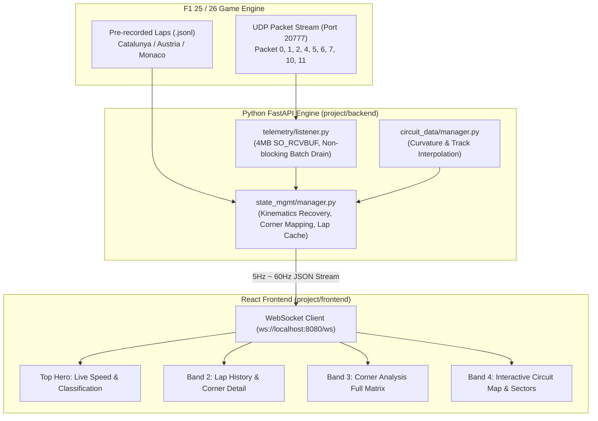

# 🏎️ F1 AI Race Engineer Dashboard

> **Institutional-grade telemetry, corner-by-corner kinematics, and real-time race strategy for F1 25 / F1 26.**

본 프로젝트는 EA SPORTS™ F1 25 / F1 26 게임의 고속 UDP 텔레메트리(기본 포트 `20777`)를 실시간으로 캡처하고, 서킷 기하학(Racing Line) 및 코너별 주행 물리를 정밀 역산하여 드라이버에게 **F1 피트월 수준의 텔레메트리 대시보드와 코칭 인사이트**를 제공하는 웹 애플리케이션입니다.

Coinbase Design System 특유의 정제된 다크 히어로 밴드, 순백의 에디토리얼 캔버스, 소프트 서피스 리듬, 그리고 고정밀 `JetBrains Mono` 수치 타이포그래피를 적용하여 가독성과 전문성을 극대화했습니다.

---

## 📸 대시보드 프리뷰 (Screenshots)

### 1. 세션 환경 설정 및 리플레이 모드 (Session Configuration)

* **Recorded Telemetry Replay**: 실제 주행 녹화 데이터셋(Catalunya 9 Laps, Austria 등)을 선택해 1x ~ 4x 배속으로 리플레이 시뮬레이션 가능.
* **실시간 UDP 수신**: 로컬 포트(`20777`), 샘플링 레이트(30Hz / 60Hz), 단위계(Metric km/h / Imperial mph) 설정.
* **AI 엔지니어 페르소나**: GP(막스 베르스타펜), Bono(루이스 해밀턴), Ricky(카를로스 사인츠) 등 전담 레이스 엔지니어 보이스 선택.

---

### 2. 랩 히스토리 및 코너별 상세 텔레메트리 (Lap Archive & Corner Telemetry)

* **멀티 랩 선택 지원**: 완주한 모든 랩(`Lap 1` ~ `Lap 9`) 및 실시간 버퍼(`LIVE`)를 자유롭게 클릭하여 조회.
* **공식 랩타임 & 섹터 스플릿**: `Packet 11`(`SessionHistory`)의 공식 랩타임과 `S1`, `S2`, `S3` 밀리초 기록 표시.
* **코너별 구체적 텔레메트리 카드 (하단 Inspector)**:
  * 각 코너 진입(Entry) / 에이펙스(Apex) / 탈출(Exit) 속도(`km/h`), 기어(`G`), 스로틀(`%`), 브레이크(`%`)
  * 브레이킹 시작 지점(`Brake Point`, m), 스로틀 재전개 지점(`Throttle On`, m), 최대 횡가속도(`Max G`)
  * 라이벌(`vs Ahead` / `vs Leader`) 코너 최저속도 및 페달 조작량 비교 막대그래프
* **차량 셋업 및 실시간 타이어 마모도 (우측)**:
  * 에어로다이내믹스, 디퍼렌셜, 서스펜션, 브레이크 바이어스 49바이트 셋업 해독
  * 4개 타이어(`FL`, `FR`, `RL`, `RR`) 실시간 표면 마모도 프로그레스 바
  * 타이어 디그레이데이션과 트랙 온도를 반영한 **AI Race Engineer Briefing**

---

### 3. 코너별 주행 매트릭스 (Turn-by-Turn Kinematics Corner Analysis)

* **전체 코너 일람 매트릭스 테이블**: 서킷의 모든 코너(`Turn 1` ~ `Turn N`)에 대해 진입/정점/탈출 속도, 기어, 스로틀, 브레이크를 표 하나로 대조.
* **빠른 랩 전환 필(Pills)**: 상단의 `LIVE`, `Lap 1` ~ `Lap 9` 버튼을 눌러 랩 간 주행 차이를 즉시 비교.
* **주요 코너링 지표**:
  * `BRAKE PT`: 이전 코너 탈출 이후 브레이킹이 시작된 정확한 거리(`m`)
  * `MAX G`: 코너 선회 중 차량에 가해진 최대 횡가속도(`G`)
  * `VS RIVAL`: 앞차/선두 대비 해당 코너 통과 델타 타임 (`-0.012s Faster` 등)

---

### 4. 인터랙티브 서킷 맵 & 섹터 분석 (Circuit Map & Sector Split Analysis)

* **Interactive SVG Circuit Map**:
  * 1,000~5,000여 개의 실제 레이싱 라인 좌표를 기반으로 한 부드러운 벡터 트랙 렌더링.
  * 각 코너의 진입(노란 점), 동적 에이펙스(빨간/파란 점 + `T1~T11`), 탈출(초록 점) 인터랙티브 마커 지원.
  * 코너 마커 클릭 시 해당 코너의 구체적인 주행 텔레메트리 팝업 표시.
  * 랩마다 드라이버가 실제로 최저 속도를 찍은 지점(Dynamic Apex)에 맞춰 마커가 실제 주행 궤적대로 이동.
  * 트랙 위 실시간 차량 위치(내 차: 초록색, 경쟁차: 흰색) 및 섹터 분할선(`S1`, `S2`, `S3`) 표시.
* **Sector Analysis (우측)**:
  * 전 랩의 공식 섹터 타임 히스토리 테이블.
  * 선택 랩의 섹터별 라이벌 대비 득실 비교 바 차트.

---

## 🛠️ 시스템 아키텍처 및 데이터 흐름



자세한 데이터 구조, 패킷 필드 정의 및 렌더링 수식은 [DATA_AND_RENDERING_GUIDE.md](docs/DATA_AND_RENDERING_GUIDE.md)를 참고하세요.

---

## 🚀 빠른 시작 (Getting Started)

### 요구 사양
* **Python**: 3.10 이상
* **Node.js**: 18.0 이상

### 1. 백엔드 실행 (Backend)
```bash
# 가상환경 활성화 (Windows PowerShell 기준)
cd project/backend
C:\Users\jahjang\python\venv\Scripts\activate

# 의존성 설치 (최초 1회)
pip install -r ../requirements.txt

# FastAPI 서버 구동 (포트 8080)
python main.py
```
> 서버 기동 시 사전 파싱된 서킷 캐시(`_parsed_laps_cache_v3.json`)를 통해 **약 28ms 만에 전체 랩 데이터가 즉시 로드**됩니다.

### 2. 프론트엔드 실행 (Frontend)
```bash
cd project/frontend

# 패키지 설치 (최초 1회)
npm install

# 개발 서버 실행 (기본 포트 5173)
npm run dev
```

웹 브라우저에서 `http://localhost:5173`으로 접속하면 대시보드를 바로 사용할 수 있습니다.

---

## 🎨 Design System
* **Coinbase Design System 준수**:
  * Canvas: `#ffffff` 순백 에디토리얼 배경
  * Hero Band: `#0a0b0d` 다크 테크니컬 영역 (카드 `#16181c`)
  * Elevation: `#f7f7f7` 소프트 그레이 밴드
  * Brand Accent: `#0052ff` Coinbase Blue
  * Status Colors: `#05b169` (Faster / Throttle), `#cf202f` (Slower / Brake)
  * Radius: 인터랙티브 버튼/태그 `100px` Pill, 컨테이너 `16px ~ 24px` Rounded Card
  * Typography: Display Font Weight `400`, 고정밀 텔레메트리 수치는 `JetBrains Mono` 및 Tabular Figures 적용
