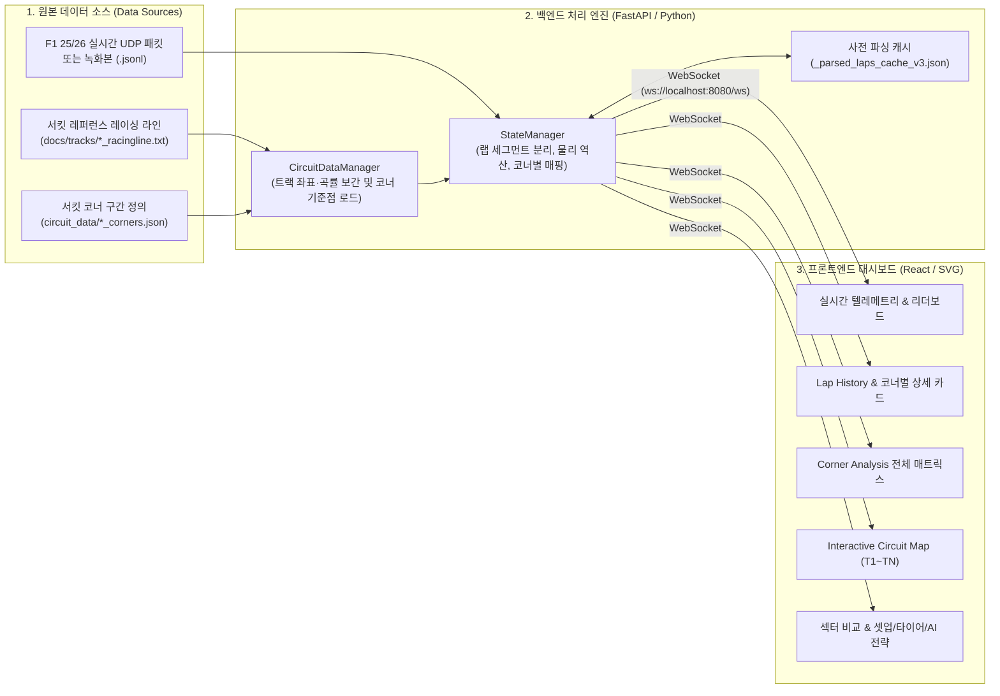
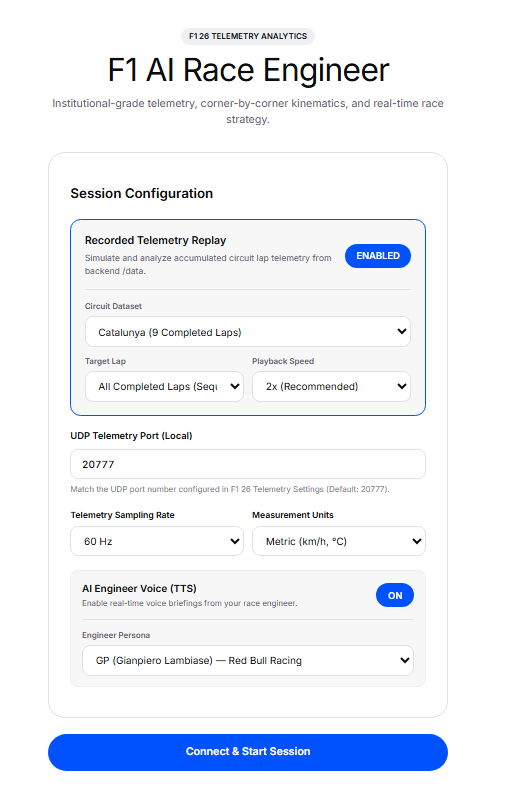
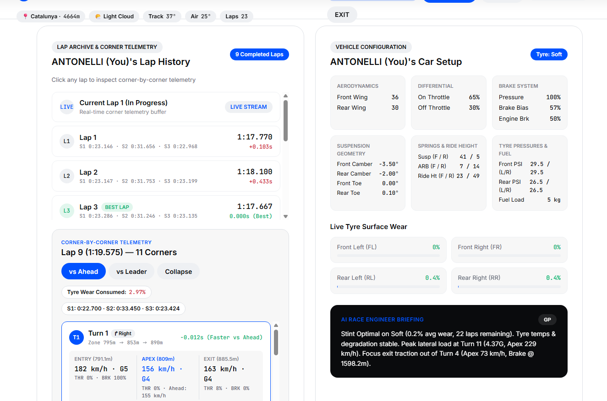
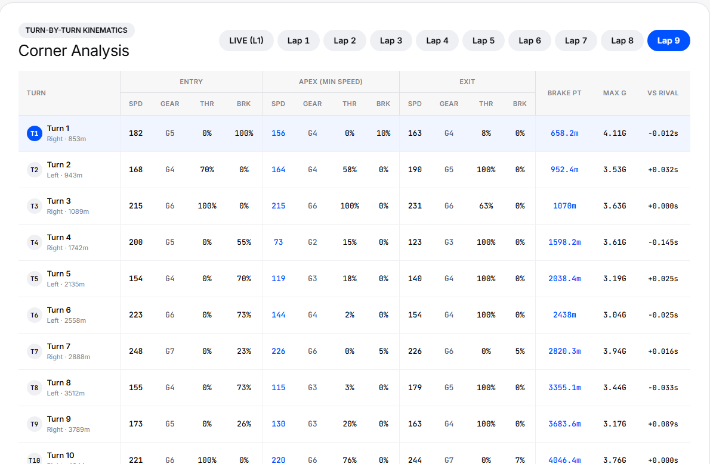
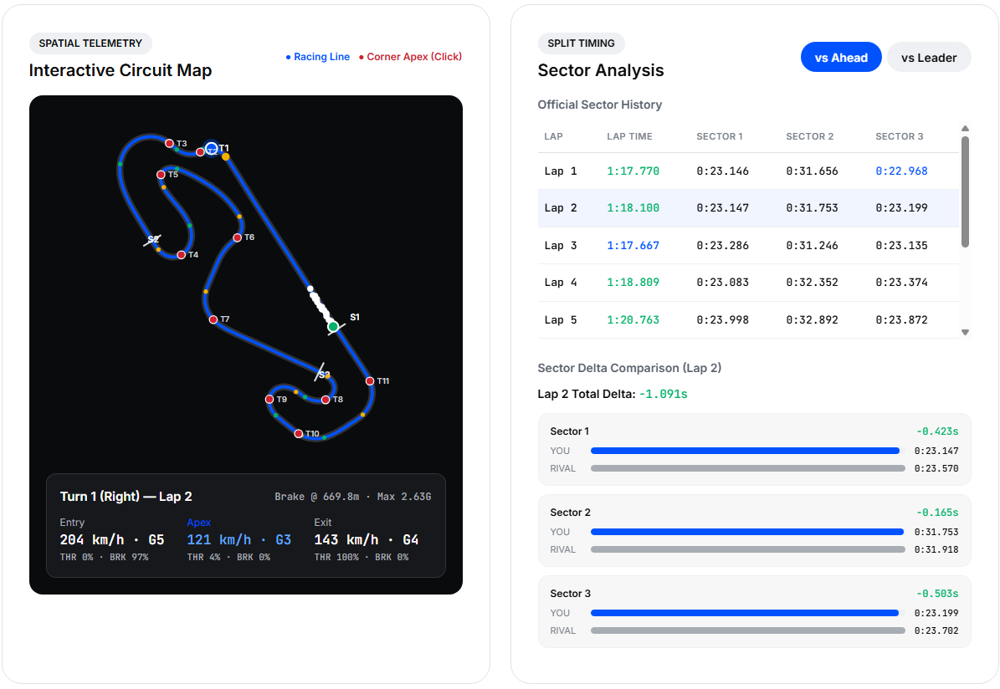

# F1 AI Race Engineer — 데이터 구조 및 화면 표현 가이드 (Data & Rendering Architecture Guide)

본 문서는 **F1 AI Race Engineer 대시보드**가 어떤 원본 데이터들을 입력받아, 백엔드에서 어떻게 가공·매핑하고, 프론트엔드 각 화면(UI 컴포넌트)에 어떻게 시각화하는지 처음 보는 사람도 쉽게 이해할 수 있도록 정리한 기술 설명서입니다.

---

## 1. 한눈에 보는 전체 데이터 파이프라인



---

## 2. 프로그램이 사용하는 3가지 핵심 데이터 소스

이 프로그램은 크게 **① 주행 텔레메트리 데이터**, **② 서킷 형상(Racing Line) 데이터**, **③ 서킷 코너 기준점(Corner Definition) 데이터**의 3가지를 결합하여 동작합니다.

### ① 주행 텔레메트리 데이터 (`project/backend/data/circuit_*/lap*.jsonl`)
F1 게임이 실시간 UDP(기본 포트 `20777`)로 송출하는 바이너리 패킷을 캡처한 데이터입니다. 리플레이 모드에서는 `.jsonl` 파일의 각 줄(0.2초 = 5Hz 주기의 스냅샷)을 읽어 재생합니다.

| 패킷 ID | 패킷 명칭 (`telemetry/packets.py`) | 주요 추출 필드 | 프로그램 내 역할 |
| :--- | :--- | :--- | :--- |
| **`packet_id_0`** | `PacketMotionData` | `m_worldPositionX`, `m_worldPositionZ`, `m_gForceLateral`, `m_gForceLongitudinal` | 차량의 3D 월드 좌표 `(X, Z)` 및 코너링 횡가속도(Lateral G) 측정 |
| **`packet_id_1`** | `PacketSessionData` | `m_trackId`, `m_trackLength`, `m_weather`, `m_trackTemperature`, `m_airTemperature`, `m_sector2LapDistanceStart`, `m_sector3LapDistanceStart` | 서킷 종류 식별, 날씨/트랙 온도 표시, 서킷 맵 내 섹터 1·2·3 분할선(`S1`, `S2`, `S3`) 거리 기준 제공 |
| **`packet_id_2`** | `PacketLapData` | `m_lapDistance`, `m_currentLapTimeInMS`, `m_lastLapTimeInMS`, `m_currentLapNum`, `m_carPosition`, `m_deltaToCarInFrontMSPart` | **핵심 기준 데이터**: 차량이 출발선으로부터 몇 미터(`m_lapDistance`) 지점을 몇 밀리초(`m_currentLapTimeInMS`)에 통과 중인지 추적, 순위 및 앞차/선두 간격 계산 |
| **`packet_id_4`** | `PacketParticipantsData` | `m_name`, `m_teamId`, `m_aiControlled` | 세션 참가 드라이버 이름(예: `VER`, `NOR`, `PLAYER (You)`) 매핑 |
| **`packet_id_5`** | `PacketCarSetupData` | `m_frontWing`, `m_rearWing`, `m_onThrottle`, `m_offThrottle`, `m_brakePressure`, `m_brakeBias`, `m_frontSuspension` 등 | 우측 `Car Setup & Tyre Wear` 카드의 에어로·서스펜션·브레이크 셋업 수치 표시 |
| **`packet_id_6`** | `PacketCarTelemetryData` | `m_speed`, `m_throttle`, `m_brake`, `m_steer`, `m_gear`, `m_engineRPM`, `m_drs` | 차량 속도(`km/h`), 스로틀(`0~100%`), 브레이크(`0~100%`), 기어(`1~8단`), DRS 활성화 여부 |
| **`packet_id_7`** | `PacketCarStatusData` | `m_visualTyreCompound` | 장착 타이어 컴파운드(`Soft`, `Medium`, `Hard`, `Inter`, `Wet`) 식별 |
| **`packet_id_10`** | `PacketCarDamageData` | `m_tyresWear[4]` | 4개 타이어(`FL`, `FR`, `RL`, `RR`) 실시간 표면 마모도(`%`) 및 랩당 타이어 소모량 산출 |
| **`packet_id_11`** | `PacketSessionHistoryData` | `m_lapHistoryData[]` (`m_lapTimeInMS`, `m_sector1TimeMSPart`, `m_sector2TimeMSPart`, `m_sector3TimeMSPart`) | 각 랩의 **공식 최종 랩타임** 및 **공식 섹터 1·2·3 기록** 추출 |

---

### ② 서킷 레퍼런스 레이싱 라인 (`project/docs/tracks/*_2020_racingline.txt`)
각 서킷의 이상적인 주행 라인을 따라 약 3~4m 간격으로 측정된 고정밀 트랙 좌표 파일입니다. (예: 카탈루냐 1,424개 포인트, 오스트리아 5,183개 포인트)

* **파일 포맷 (CSV 형태)**:
  ```text
  dist, x, z, y, ...
  0.34, 152.71, -408.82, ...
  3.62, 150.89, -411.65, ...
  ```
* **역할 (`CircuitDataManager`)**:
  1. 프론트엔드 **Circuit Map**의 배경 서킷 실루엣(파란색 트랙 외곽선)을 그리는 기준선(`reference_track`)이 됩니다.
  2. 인접한 세 점의 벡터 외적($\vec{v}_1 \times \vec{v}_2$)을 통해 트랙 전 구간의 **곡률(`curv`)과 회전 방향(`Left` / `Right`)**을 계산합니다.
  3. 임의의 주행 거리(`dist`, 단위 `m`)가 주어졌을 때 해당 거리에서의 정확한 월드 좌표 `(x, z)`를 선형 보간(`interpolate_point`)합니다.

---

### ③ 서킷 코너 구간 정의 (`project/backend/circuit_data/*_2020_racingline_corners.json`)
서킷별로 어디서부터 어디까지가 몇 번 코너(`Turn 1 ~ Turn N`)인지를 출발선 기준 거리(`m`)로 정의한 파일입니다.
* **사용 파일**:
  * 카탈루냐 (`track_id = 4`): `catalunya_2020_racingline_corners.json` (Turn 1 ~ Turn 11)
  * 모나코 (`track_id = 5`): `monaco_2020_racingline_corners.json` (Turn 1 ~ Turn 16)
  * 오스트리아 (`track_id = 17`): `austria_2020_racingline_corners.json` (Turn 1 ~ Turn 7)
* **파일 구조 예시 (`catalunya_2020_racingline_corners.json`)**:
  ```json
  {
    "turn": 1,
    "name": "Turn 1",
    "entry_dist": 795,
    "apex_dist": 853,
    "exit_dist": 890
  }
  ```
  * `entry_dist`: 코너 진입 기준 거리 (`795m`)
  * `apex_dist`: 코너의 기하학적 정점(Nominal Apex) 기준 거리 (`853m`)
  * `exit_dist`: 코너 탈출 기준 거리 (`890m`)

---

## 3. 서킷 맵의 코너 포인트(`T1~TN`) 매핑 원리와 랩마다 위치가 조금씩 달라지는 이유

### Q1. 서킷 맵의 T포인트(`T1 ~ T11`)는 `catalunya_2020_racingline_corners.json`을 기준으로 매핑되는가?
**네, 맞습니다.** 모든 코너의 탐색 구간은 `catalunya_2020_racingline_corners.json`에 정의된 `entry_dist`(진입) ~ `apex_dist`(정점) ~ `exit_dist`(탈출) 미터(m) 구간을 기준으로 삼습니다.

### Q2. 왜 랩(Lap)을 바꿀 때마다 서킷 맵의 T포인트(`T1~T11`) 위치가 미세하게 달라지는가?
그 이유는 백엔드의 코너 분석기(`StateManager._analyze_corners`)가 단순 고정 좌표가 아니라, **`corners.json`의 코너 구간 안에서 플레이어가 해당 랩에 실제로 기록한 동적 에이펙스(Dynamic Apex, 실제 최저 속도 지점)를 찾아 매핑**하기 때문입니다.

구체적인 동작 과정은 다음과 같습니다 (`project/backend/state_mgmt/manager.py` 904~980행):

1. **코너 탐색 구간 설정 (`corners.json` 기준)**
   * 예를 들어 카탈루냐 `Turn 1`의 기준 구간이 `entry_dist = 795m`, `apex_dist = 853m`, `exit_dist = 890m`로 주어집니다.
2. **해당 랩의 실제 최저 속도 지점(Dynamic Apex) 탐색**
   * 드라이버는 매 랩마다 브레이킹 타이밍이나 코너 진입 라인이 조금씩 다릅니다.
   * 어떤 랩(예: Lap 2)에서는 브레이킹을 일찍 시작해 **`842m` 지점**에서 최저 속도(`142 km/h`)를 찍고 가속을 시작하고, 다른 랩(예: Lap 3)에서는 브레이킹이 늦어(Late Braking) 코너 깊숙한 **`864m` 지점**에서 최저 속도(`131 km/h`)를 기록합니다.
   * 코너 분석기는 `[entry_dist - 15m, exit_dist + 15m]` 구간 내의 해당 랩 텔레메트리 포인트들 중 **실제로 속도가 가장 낮았던 포인트(`min(apex_window, key=lambda p: p['speed'])`)**를 그 랩의 진짜 에이펙스(`apex_pt`)로 채택합니다.
3. **샘플링 간격에 따른 실제 통과 좌표 반영**
   * 또한 진입점(`entry_pt`)과 탈출점(`exit_pt`) 역시 해당 랩에 수집된 0.2초 단위 텔레메트리 포인트 중 `entry_dist`, `exit_dist`에 가장 가까운 실제 주행 샘플의 좌표 `(x, z)`를 가져옵니다.
4. **결과**
   * 서킷 맵의 노란 점(`Entry`), 빨간/파란 점(`Apex`, `T1~T11` 라벨), 초록 점(`Exit`)은 **"이 랩에서 드라이버가 실제로 코너에 진입하고, 최저 속도를 찍고, 탈출한 위치"**를 보여주므로 랩을 클릭할 때마다 당시 주행 궤적에 맞춰 조금씩 이동합니다.
   * 테이블에 함께 적힌 고정 거리(예: `Right · 853.0m`)는 `corners.json`의 기준 거리(`nom_apex_dist`)이고, 하단 상세 바의 `Apex: 842.6m`는 해당 랩에서 실제로 최저 속도가 기록된 거리(`apex_dist`)입니다.

---

## 4. 화면(UI) 섹션별 사용 데이터 및 계산 방식

### ① 초기 세션 환경 설정 (Session Configuration)

* **Recorded Telemetry Replay 토글**: 백엔드 `data/circuit_*/`에 저장된 녹화 데이터를 1x~4x 속도로 모의 스트리밍하거나 실시간 F1 게임 UDP(`20777`) 수신으로 전환합니다.
* **AI Engineer Voice**: 레이스 도중 타이어/코너 상황을 음성으로 전달할 엔지니어 페르소나(`GP`, `Bono`, `Ricky`)를 지정합니다.

---

### ② Band 2: Lap History & 코너별 텔레메트리 카드 & 차량 셋업

* **랩 목록 (`Lap 1 ~ Lap 9`, `LIVE`)**:
  * **랩타임(`time`) 및 섹터 타임(`S1, S2, S3`)**: `packet_id_11`(`SessionHistory`)에 기록된 공식 밀리초 기록을 `분:초.밀리초` 포맷으로 변환해 표시합니다.
  * **베스트 랩 델타(`delta`)**: 완주한 모든 랩 중 가장 빠른 랩(`BEST LAP`)을 기준으로 각 랩의 시간 차이(`+0.383s` 등)를 계산합니다.
  * **타이어 소모량(`Tyre Wear Consumed`)**: 해당 랩 시작 시점과 종료 시점의 4개 타이어 평균 마모도 차이(`packet_id_10.m_tyresWear`)를 계산합니다.
* **선택한 랩의 코너별 상세 카드 (`Turn 1 ~ Turn N`)**:
  * 좌측에서 클릭한 랩(`selectedLap`)의 `corners` 배열을 순회하며 각 코너의 구체적인 주행 지표를 보여줍니다:
    * **Entry / Apex / Exit**: 각 지점 통과 시의 속도(`km/h`), 기어(`G1~G8`), 스로틀(`%`), 브레이크(`%`)
    * **Braking Point (`brake_point`)**: 이전 코너 탈출 이후 ~ 현재 코너 에이펙스 사이에서 브레이크가 `5%` 이상 밟히기 시작한 최초 거리(`m`) 또는 감속 시작 거리(`m`)
    * **Throttle On (`throttle_on_dist`)**: 에이펙스 통과 직후 스로틀을 다시 `25%` 이상 전개하기 시작한 거리(`m`)
    * **Max Lateral G (`max_g_lat`)**: 코너 통과 중 발생한 최대 횡가속도(`G`)
    * **vs Ahead / vs Leader 비교 바**: 동일 코너에서 앞차(`ahead`) 또는 선두(`leader`) 차량이 기록한 브레이크 답력, 스로틀 전개량, 에이펙스 최저 속도를 내 기록과 나란히 막대그래프로 비교합니다.
* **차량 셋업 (우측 상단)**: `packet_id_5`에서 파싱한 프론트/리어 윙 수치, 온/오프 스로틀 디퍼렌셜, 서스펜션 지오메트리, 브레이크 압력 및 밸런스를 표시합니다.
* **Live Tyre Surface Wear (우측 중단)**: `packet_id_10`의 `m_tyresWear[0..3]` 배열을 통해 `FL`, `FR`, `RL`, `RR` 각 타이어 마모율을 프로그레스 바로 표시합니다.
* **AI Race Engineer Briefing (우측 하단)**: 현재 타이어 마모도, 앞차와의 코너 속도 차이, 랩타임 추이를 종합하여 생성된 레이스 엔지니어 브리핑 메시지를 출력합니다.

---

### ③ Band 3: Corner Analysis (전체 코너 매트릭스 테이블)

* 선택된 랩의 모든 코너(`Turn 1 ~ Turn N`)를 한눈에 비교할 수 있는 종합 표입니다.
* 상단의 빠른 랩 전환 버튼(`LIVE`, `Lap 1` ~ `Lap 9`)을 눌러 랩 간 코너 진입/정점/탈출 속도 및 브레이킹 포인트 변화를 즉시 대조할 수 있습니다.
* 특정 행(Row)을 클릭하면 하단의 딥다이브 요약 바와 서킷 맵의 해당 코너 마커가 동시에 하이라이트됩니다.

---

### ④ Band 4: Interactive Circuit Map & Sector Analysis

* **Interactive Circuit Map**:
  * `reference_track` 좌표를 SVG 뷰포트(`400x400`)에 맞게 자동 스케일링하여 서킷 전체 모양을 그립니다.
  * `packet_id_1`의 섹터 시작 거리(`m_sector2LapDistanceStart`, `m_sector3LapDistanceStart`)에 수직 분할선(`S1`, `S2`, `S3`)을 표시합니다.
  * 각 코너의 진입(노란 점), 에이펙스(빨간/파란 점 + `T1~TN`), 탈출(초록 점) 마커를 그리고, 클릭 시 하단 인스펙터 박스에 해당 코너의 텔레메트리를 표시합니다.
* **Sector Analysis**:
  * 섹터 1, 섹터 2, 섹터 3 각각의 내 시간과 라이벌 대비 득실(`Faster` / `Slower`), 그리고 전체 랩의 섹터별 기록 히스토리를 테이블로 제공합니다.

---

## 5. 과거 녹화본(`.jsonl`)의 패킷 누락 보정 및 캐싱 구조

1. **물리 기반 역산 복원 (`StateManager._build_points_from_segment`)**
   * 실시간 게임 연결 시에는 `packet_id_6`(`CarTelemetry`)와 `packet_id_0`(`Motion`)의 원시 값을 그대로 사용합니다.
   * 단, 과거 녹화된 일부 대용량 `.jsonl` 파일에서 UDP 버퍼 오버플로우로 인해 `packet_id_6`의 프레임이 갱신되지 않은 구간이 감지되면(`abs(p2_frame - p6_frame) > 15`), 정상 기록된 `packet_id_2`의 주행 거리(`m_lapDistance`)와 경과 시간(`m_currentLapTimeInMS`)의 변화율로부터:
     * **실제 구간 주행 속도**: $v = \frac{\Delta d}{\Delta t} \times 3.6\text{ (km/h)}$
     * **종방향 가감속도**: $a_{\text{lon}} = \frac{\Delta v}{\Delta t}\text{ (m/s}^2\text{)}$ $\rightarrow$ 브레이크 답력(`%`), 스로틀 전개량(`%`), 브레이킹 포인트(`m`)
     * **횡방향 가속도**: $G_{\text{lat}} = \frac{v^2 \cdot |\kappa|}{9.81}\text{ (G)}$ (서킷 곡률 $\kappa$ 결합)
     를 물리적으로 역산하여 모든 랩의 코너 주행 데이터를 누락 없이 복원합니다.
2. **고속 디스크 캐시 (`_parsed_laps_cache_v3.json`)**
   * 수백 MB에서 1GB에 달하는 `.jsonl` 파일들을 매번 처음부터 다시 읽지 않도록, 최초 1회 파싱 후 각 서킷 폴더(`data/circuit_*/_parsed_laps_cache_v3.json`)에 분석 완료된 랩 및 코너 데이터를 캐싱합니다.
   * 이를 통해 서버 재시작이나 서킷 전환 시 약 **0.03초(28ms)** 만에 전체 랩과 코너 데이터가 로드됩니다.
